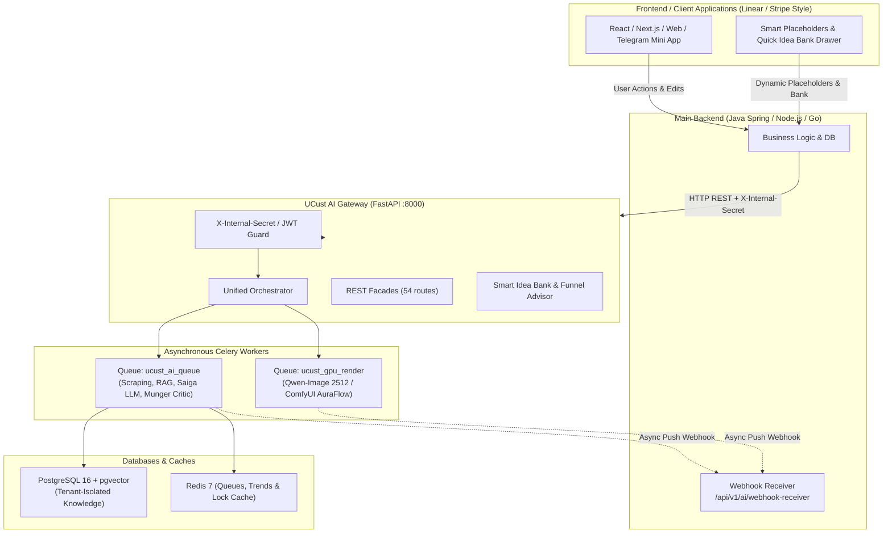
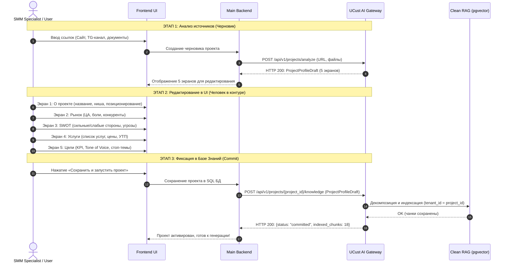
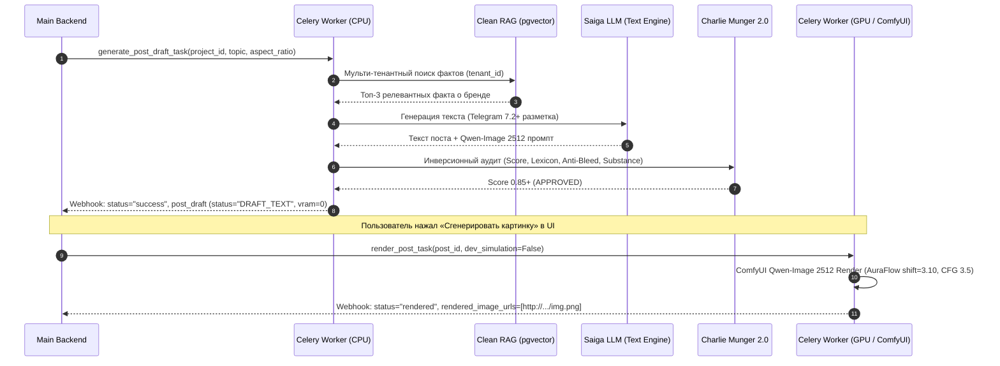

# 📘 UCust AI Service Gateway — Руководство по интеграции для Бэкенда (v2.7.0)

Полная техническая спецификация подключения основного бэкенда (Java Spring / Node.js / Go / Python) к микросервису **UCust AI Gateway**.

---

## 1. Архитектурный обзор и варианты подключения

Микросервис **UCust AI** предоставляет единую платформу для анализа брендов, извлечения Brand DNA, многоуровневого векторного поиска (Clean RAG с Multi-Tenant изоляцией), генерации контента для социальных сетей (Telegram 7.2+, VK), промпт-инжиниринга визуалов нового поколения (**Qwen-Image 2512** / ComfyUI), аудита качества (**Charlie Munger 2.0**) и смарт-банка идей с защитой воронок продаж.



---

## 2. Базовые параметры подключения и безопасность

| Параметр | Значение | Описание |
| :--- | :--- | :--- |
| **Базовый URL (Production)** | `http://<AI_HOST>:8000` | Хост AI-сервиса (FastAPI) |
| **Интерактивный Swagger UI** | `http://<AI_HOST>:8000/docs` | Документация и тестирование запросов через веб-интерфейс |
| **Схема OpenAPI 3.1 (JSON)** | `http://<AI_HOST>:8000/openapi.json` | Спецификация для кодогенерации DTO (Java, TypeScript, Go) |
| **Header безопасности** | `X-Internal-Secret: ucust-super-secret-service-token-2026` | Обязательный заголовок сервисной авторизации |
| **Метрики Prometheus** | `http://<AI_HOST>:8000/metrics` | Экспорт метрик производительности и очередей (OpenMetrics) |
| **Раздача медиа** | `http://<AI_HOST>:8000/output/photos/...` | Статический доступ к сгенерированным фото и баннерам |

---

## 3. Сценарии интеграции

### Сценарий 1: Human-in-the-Loop (HITL) Онбординг проекта (5 Экранов)

Процесс регистрации проекта в системе разделен на два изолированных этапа:
1. **Анализ и предзаполнение черновика:** Парсинг сайта, соцсетей, извлечение палитры и SWOT.
2. **Верификация и коммит:** Человек проверяет данные, после чего профиль векторизуется с изоляцией по `tenant_id`.



---

### Сценарий 2: Генерация контента (Telegram 7.2+, Qwen-Image 2512 & Charlie Munger 2.0)

Генерация контента построена на архитектуре **двухфазного рендеринга (Lazy Rendering)**:
1. **Фаза 1 (Текст + Pre-Mortem + Визуальный промпт):** Выполняется за 0.4–1.2 сек. Стоимость GPU = **0 VRAM**. Возвращается `PostDraft` со статусом `DRAFT_TEXT` и структурированным 6-компонентным промптом под **Qwen-Image 2512**.
2. **Фаза 2 (Рендер изображения):** Запускается только по запросу пользователя или таймеру публикации в очереди `ucust_gpu_render` с параметрами сэмплера `ModelSamplingAuraFlow (shift=3.10)` и `VAEDecodeTiled (512/64)`.



---

### Сценарий 3: Смарт-банк идей, динамические плейсхолдеры и защита воронки

Интерфейсно банк идей отделен от автоматического календаря воронки продаж, чтобы исключить затирание важных конверсионных постов вирусными темами:
1. **Динамические подсказки в плейсхолдер:** `GET /api/v1/ideas/placeholders` подгружает 3–5 ситуативных тем из календаря праздников с поддержкой Tab-автозаполнения.
2. **Банк быстрых идей:** `GET /api/v1/ideas/bank` отдает каталог инфоповодов с классификацией этапа воронки (`TOFU`/`MOFU`/`BOFU`) и углом подачи.
3. **Советник размещения (Funnel Placement Advisor):** `POST /api/v1/ideas/evaluate-placement` проверяет, куда безопасно поставить тему (в черновик, внеплановый сторис или определенный слот). При попытке перезаписать активный BOFU-оффер вирусным мемом сервис возвращает статус `warning` с защитой воронки.

---

## 4. Реестр ключевых эндпоинтов (54 routes)

| Группа | Метод и URL | Назначение |
| :--- | :--- | :--- |
| **Smart Idea Bank** | `GET /api/v1/ideas/placeholders` | Подгрузка контекстных тем в плейсхолдер поля ввода с поддержкой Tab-completion. |
| **Smart Idea Bank** | `GET /api/v1/ideas/bank` | Каталог ситуативных инфоповодов (праздники СНГ, отраслевые дни) с воронкой. |
| **Smart Idea Bank** | `POST /api/v1/ideas/evaluate-placement` | Оценка совместимости темы с воронкой и защита конверсионных слотов. |
| **HITL Onboard** | `POST /api/v1/projects/analyze`<br>`POST /api/v1/parser/analyze` | **Фаза 1:** Сбор данных по ссылкам и генерация `ProjectProfileDraft` без записи в БД. |
| **HITL Commit** | `POST /api/v1/projects/{project_id}/knowledge`<br>`POST /api/v1/projects/commit` | **Фаза 2:** Фиксация подтвержденного профиля в RAG/pgvector с тенантом `project_id`. |
| **Orchestrator** | `POST /api/v1/task/execute`<br>`POST /api/v1/orchestrator/execute` | **Единый шлюз задач**. Маршрутизирует любую операцию по `task_type`. |
| **Direct Gen** | `POST /orchestration/generate`<br>`POST /api/v1/orchestration/generate` | Прямая синхронная генерация поста с контекстом бренда. |
| **Async Tasks** | `POST /api/v1/ai/tasks/async-generate` | Асинхронная постановка задачи в очередь Celery с Push-вебхуком. |
| **Task Status** | `GET /api/v1/ai/tasks/{task_id}/status` | Проверка статуса выполнения фоновой задачи. |
| **Render Post** | `POST /api/v1/ai/tasks/render/{post_id}` | Запуск отложенного GPU-рендеринга для сгенерированного черновика. |
| **RAG Query** | `POST /api/v1/ai/rag/query` | Семантический поиск по базе знаний с multi-tenant изоляцией. |
| **Trends & Memes**| `GET /api/v1/ai/trends` | Быстрая отдача кэшированных трендов ниши (3–5 мс). |
| **Critic Review** | `POST /api/v1/ai/critic/review` | Прямой аудит текста критиком Charlie Munger 2.0. |
| **Observability** | `GET /metrics` | Экспорт Prometheus метрик (латентность, очереди, VRAM). |
| **Health** | `GET /health` или `GET /api/v1/ai/health` | Проверка жизнеспособности сервиса и загруженных моделей. |

---

## 5. Готовые примеры интеграционных запросов

### Пример 1: Получение динамических плейсхолдеров (`GET /api/v1/ideas/placeholders`)

```http
GET http://<AI_HOST>:8000/api/v1/ideas/placeholders?niche=IT&company_name=DevPulse&limit=3
X-Internal-Secret: ucust-super-secret-service-token-2026
```

**Ответ (HTTP 200):**
```json
{
  "status": "success",
  "niche": "IT",
  "company_name": "DevPulse",
  "placeholders": [
    {
      "placeholder_text": "💡 Идея (через 8 дн.): День программиста — как команда DevPulse встречает этот день?",
      "suggested_topic": "День программиста: как DevPulse встречает праздник и что приготовил для клиентов",
      "source_type": "calendar",
      "funnel_stage": "TOFU",
      "hint": "Нажмите Tab для автозаполнения"
    },
    {
      "placeholder_text": "💡 Идея: 3 скрытые ошибки в CI/CD пайплайне, сжигающие бюджет команды",
      "suggested_topic": "Разбор кейса: как оптимизация тестов сократила время деплоя на 60%",
      "source_type": "evergreen",
      "funnel_stage": "MOFU",
      "hint": "Нажмите Tab для B2B разбора"
    }
  ]
}
```

---

### Пример 2: Проверка безопасности размещения в воронку (`POST /api/v1/ideas/evaluate-placement`)

```http
POST http://<AI_HOST>:8000/api/v1/ideas/evaluate-placement
Content-Type: application/json
X-Internal-Secret: ucust-super-secret-service-token-2026
```

```json
{
  "topic": "Всемирный день кошек: веселые фотографии пушистых питомцев команды",
  "niche": "IT / Разработка",
  "company_name": "DevPulse",
  "target_slot_date": "2026-10-02",
  "target_slot_type": "BOFU_CONVERSION_OFFER",
  "is_override_scheduled_slot": true
}
```

**Ответ (HTTP 200):**
```json
{
  "status": "success",
  "verdict": {
    "is_funnel_safe": false,
    "placement_status": "warning",
    "detected_funnel_stage": "TOFU_UNAWARE",
    "recommended_target": "draft",
    "marketing_framework": "BAB",
    "cta_guidance": "Мягкое вовлечение / Реакции (Без прямого жесткого CTA на покупку)",
    "explanation": "⚠️ Внимание: Выбранный слот в календаре предназначен для конверсии и продаж (BOFU_CONVERSION_OFFER), а тема «Всемирный день кошек» является вирусной/охватной (TOFU). Прямая замена разрушит прогрев аудитории. Рекомендуем сохранить идею в черновики или опубликовать как внеплановый сторис/пост выходного дня.",
    "alternative_slots": [
      "draft",
      "unscheduled_story",
      "weekend_lifestyle_slot"
    ]
  }
}
```

---

### Пример 3: Постановка задачи генерации в Celery с Webhook (`POST /api/v1/task/execute`)

```http
POST http://<AI_HOST>:8000/api/v1/task/execute
Content-Type: application/json
X-Internal-Secret: ucust-super-secret-service-token-2026
```

```json
{
  "task_type": "generate_post",
  "project_id": "project_101",
  "prompt": "Рассказать о правильной температуре воды для заваривания светлой обжарки",
  "aspect_ratio": "1:1",
  "callback_url": "https://backend.ucust.ai/api/v1/ai/webhook-receiver"
}
```

**Ответ (HTTP 202 Accepted):**
```json
{
  "status": "accepted",
  "task_id": "celery-task-9481ad-491",
  "message": "Задача принята в фоновую обработку. Результат будет отправлен на callback_url"
}
```

---

## 6. Спецификация обратного вебхука (Push Webhook)

После завершения генерации текста или рендеринга визуала AI-сервис отправляет HTTP POST запрос на переданный `callback_url`.

### Формат входящего Webhook-запроса от AI:

```http
POST https://backend.ucust.ai/api/v1/ai/webhook-receiver
Content-Type: application/json
X-Internal-Secret: ucust-super-secret-service-token-2026
X-UCust-Signature: sha256=d3b07384d113edec49eaa6238ad5ff00...
```

```json
{
  "task_id": "celery-task-9481ad-491",
  "event_type": "content_draft_ready",
  "tenant_id": "project_101",
  "status": "success",
  "timestamp": 1789851600,
  "data": {
    "status": "success",
    "project_id": "project_101",
    "post_draft": {
      "post_id": "post_a9103de4",
      "brand_id": "project_101",
      "status": "draft_text",
      "text_content": "☕ <b>Секрет идеальной экстракции светлой обжарки</b>\n\nПочему вода 100°C может испортить чашку, а 92°C раскроет букет?\n\n<blockquote expandable>\nСветлая обжарка сохраняет органические кислоты и деликатные эфирные масла. При температуре 91-93°C вы получаете баланс цитрусовой сладости без излишней терпкости.\n</blockquote>\n\nПромокод на кофе недели: <code>LIGHT2026</code> (скидка 15%).",
      "critic_score": 0.95,
      "critic_verdict": "APPROVED",
      "image_specs": [
        {
          "prompt": "A commercial photograph of artisan ceramic cup with silky velvety microfoam latte art resting on a smooth travertine surface. In the foreground, vibrant green leaf frames the shot. Shot on 85mm f/1.8 macro lens with creamy shallow depth of field, tactile material micro-textures, zero CGI.",
          "negative_prompt": "blurry, low quality, pixelated, distorted, watermark, oversaturated, plastic-looking, 3D render, CGI, cartoon, anime",
          "aspect_ratio": "1:1",
          "width": 1024,
          "height": 1024,
          "sampling_config": {
            "sampler": "euler",
            "scheduler": "normal",
            "shift": 3.10,
            "cfg": 3.5,
            "steps": 35
          }
        }
      ],
      "rendered_image_urls": [],
      "vram_cost_mb": 0
    }
  }
}
```

---

## 7. Локальная разработка и Mock-сервер (Ветка `mock-ai`)

Для разработки и тестирования бэкенда без необходимости разворачивать GPU, тяжелые LLM и локальные веса моделей доступен легковесный **UCust AI Mock Server**:

### Запуск Mock-сервера:
```bash
# 1. Переключение на моковую ветку
git checkout mock-ai

# 2. Установка зависимостей (только FastAPI и Uvicorn)
pip install -r ai_mock/requirements.txt

# 3. Запуск сервера
python start_mock.py
```

- Mock-сервер поднимается на порту `8000` (`http://localhost:8000`).
- Полностью реализует все **54 контрактных эндпоинта** (включая `/api/v1/ideas/placeholders`, `/api/v1/ideas/bank`, `/api/v1/ideas/evaluate-placement`, `/api/v1/projects/analyze`, `/api/v1/projects/{project_id}/knowledge`, `/api/v1/task/execute`, `/metrics`).
- Возвращает мгновенные валидные ответы, имитирует задержки очередей и отправляет тестовые Webhook-коллбэки на указанный `callback_url`.
