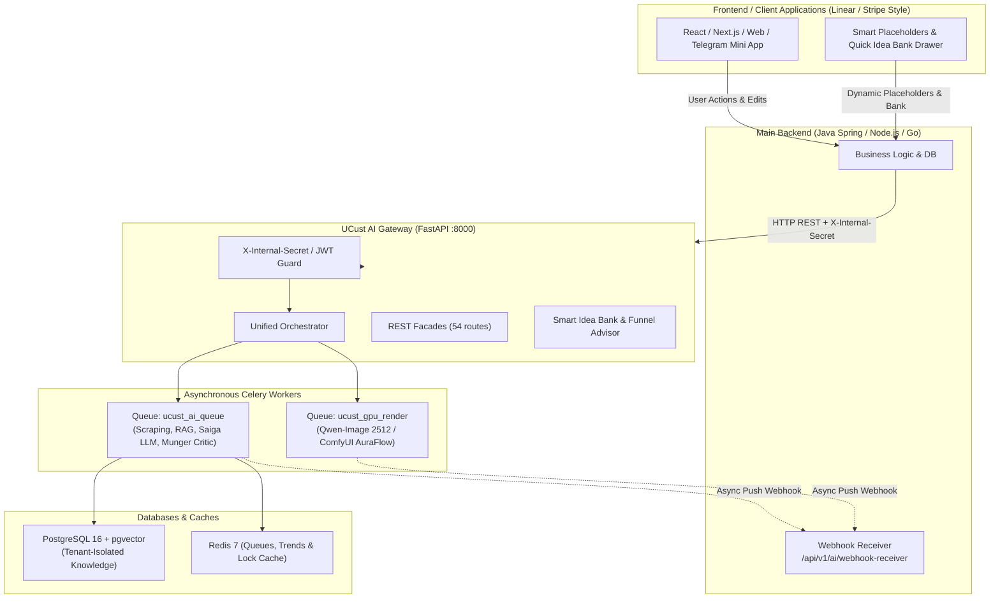
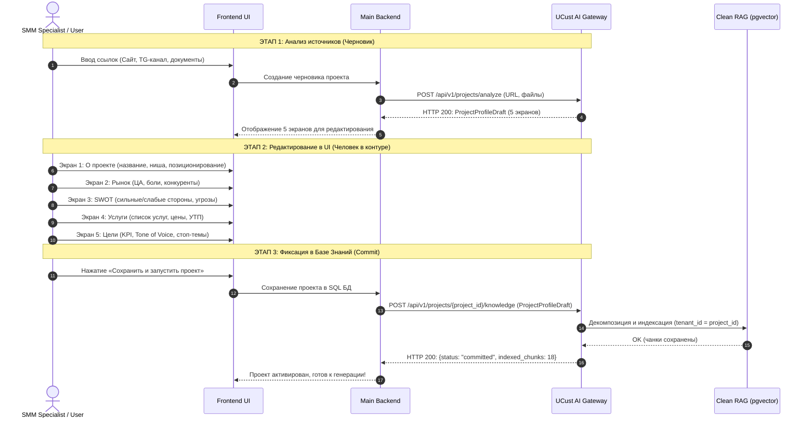
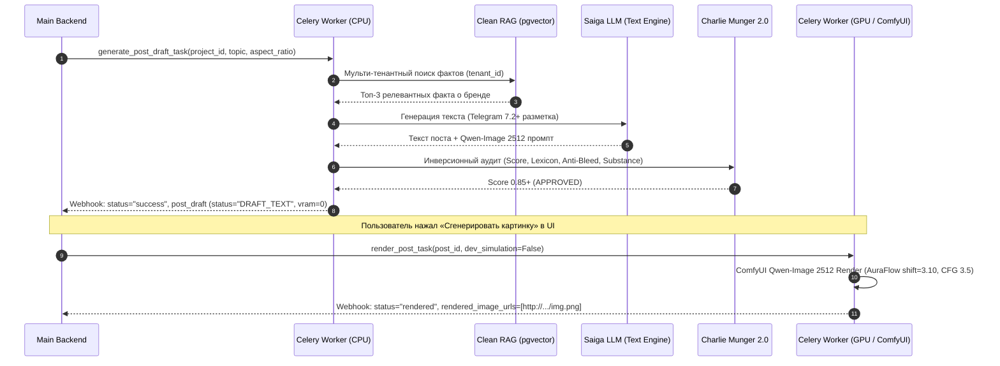
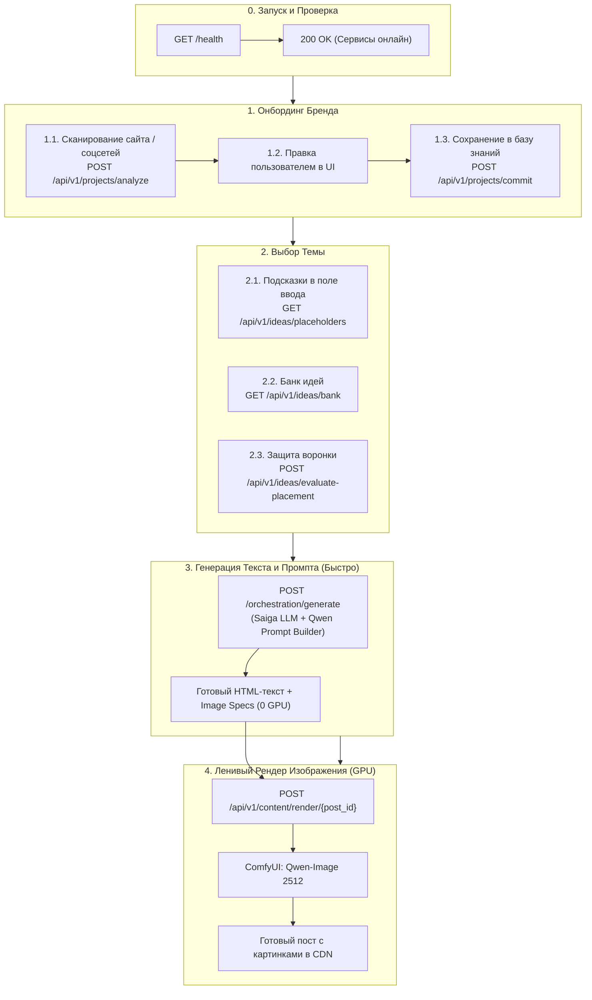
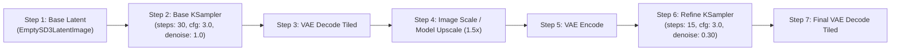
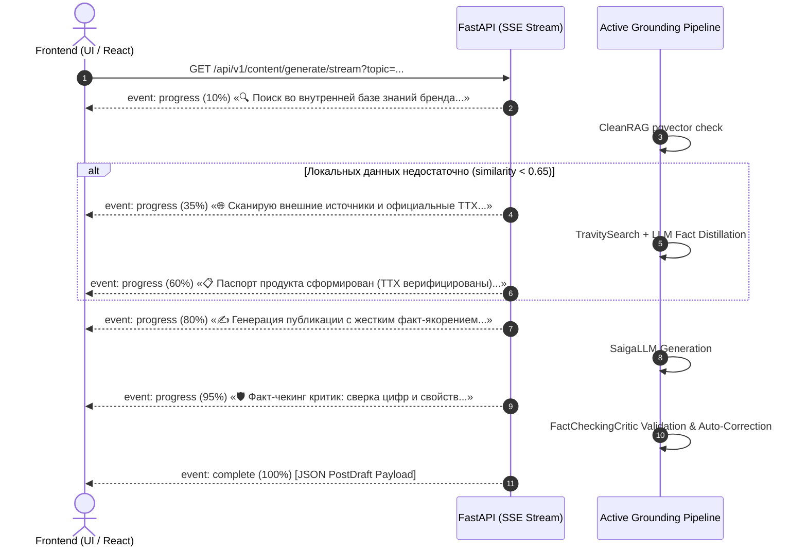
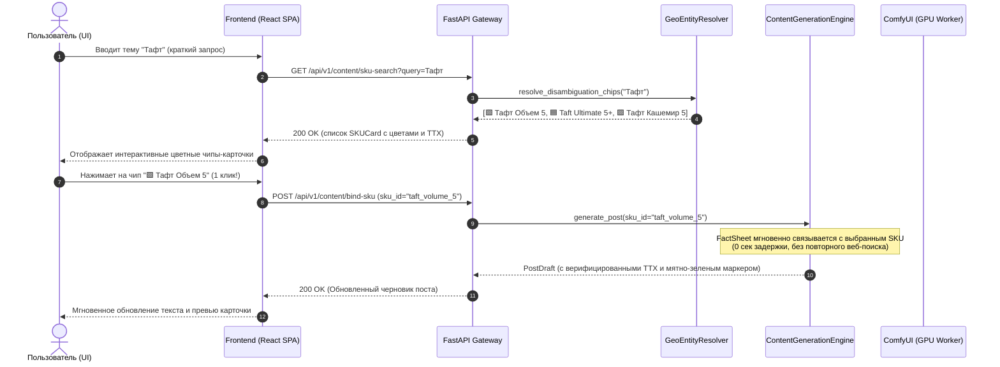

# 📘 UCust AI Service Gateway — Руководство по интеграции для Бэкенда (v2.7.0)

Полная техническая спецификация подключения основного бэкенда (Java Spring / Node.js / Go / Python) к микросервису **UCust AI Gateway**.

---

## 1. Архитектурный обзор и варианты подключения

Микросервис **UCust AI** предоставляет единую платформу для анализа брендов, извлечения Brand DNA, многоуровневого векторного поиска (Clean RAG с Multi-Tenant изоляцией), генерации контента для социальных сетей (Telegram 7.2+, VK), промпт-инжиниринга визуалов нового поколения (**Qwen-Image 2512** / ComfyUI), аудита качества (**Charlie Munger 2.0**) и смарт-банка идей с защитой воронок продаж.



---

## 2. Базовые параметры подключения и безопасность

| Параметр | Значение | Описание |
| :--- | :--- | :--- |
| **Базовый URL (Production)** | `http://<AI_HOST>:8000` | Хост AI-сервиса (FastAPI) |
| **Интерактивный Swagger UI** | `http://<AI_HOST>:8000/docs` | Документация и тестирование запросов через веб-интерфейс |
| **Схема OpenAPI 3.1 (JSON)** | `http://<AI_HOST>:8000/openapi.json` | Спецификация для кодогенерации DTO (Java, TypeScript, Go) |
| **Header безопасности** | `X-Internal-Secret: ucust-super-secret-service-token-2026` | Обязательный заголовок сервисной авторизации |
| **Метрики Prometheus** | `http://<AI_HOST>:8000/metrics` | Экспорт метрик производительности и очередей (OpenMetrics) |
| **Раздача медиа** | `http://<AI_HOST>:8000/output/photos/...` | Статический доступ к сгенерированным фото и баннерам |

---

## 3. Сценарии интеграции

### Сценарий 1: Human-in-the-Loop (HITL) Онбординг проекта (5 Экранов)

Процесс регистрации проекта в системе разделен на два изолированных этапа:
1. **Анализ и предзаполнение черновика:** Парсинг сайта, соцсетей, извлечение палитры и SWOT.
2. **Верификация и коммит:** Человек проверяет данные, после чего профиль векторизуется с изоляцией по `tenant_id`.



---

### Сценарий 2: Генерация контента (Telegram 7.2+, Qwen-Image 2512 & Charlie Munger 2.0)

Генерация контента построена на архитектуре **двухфазного рендеринга (Lazy Rendering)**:
1. **Фаза 1 (Текст + Pre-Mortem + Визуальный промпт):** Выполняется за 0.4–1.2 сек. Стоимость GPU = **0 VRAM**. Возвращается `PostDraft` со статусом `DRAFT_TEXT` и структурированным 6-компонентным промптом под **Qwen-Image 2512**.
2. **Фаза 2 (Рендер изображения):** Запускается только по запросу пользователя или таймеру публикации в очереди `ucust_gpu_render` с параметрами сэмплера `ModelSamplingAuraFlow (shift=3.10)` и `VAEDecodeTiled (512/64)`.



---

### Сценарий 3: Смарт-банк идей, динамические плейсхолдеры и защита воронки

Интерфейсно банк идей отделен от автоматического календаря воронки продаж, чтобы исключить затирание важных конверсионных постов вирусными темами:
1. **Динамические подсказки в плейсхолдер:** `GET /api/v1/ideas/placeholders` подгружает 3–5 ситуативных тем из календаря праздников с поддержкой Tab-автозаполнения.
2. **Банк быстрых идей:** `GET /api/v1/ideas/bank` отдает каталог инфоповодов с классификацией этапа воронки (`TOFU`/`MOFU`/`BOFU`) и углом подачи.
3. **Советник размещения (Funnel Placement Advisor):** `POST /api/v1/ideas/evaluate-placement` проверяет, куда безопасно поставить тему (в черновик, внеплановый сторис или определенный слот). При попытке перезаписать активный BOFU-оффер вирусным мемом сервис возвращает статус `warning` с защитой воронки.

---

## 4. Реестр ключевых эндпоинтов (54 routes)

| Группа | Метод и URL | Назначение |
| :--- | :--- | :--- |
| **Smart Idea Bank** | `GET /api/v1/ideas/placeholders` | Подгрузка контекстных тем в плейсхолдер поля ввода с поддержкой Tab-completion. |
| **Smart Idea Bank** | `GET /api/v1/ideas/bank` | Каталог ситуативных инфоповодов (праздники СНГ, отраслевые дни) с воронкой. |
| **Smart Idea Bank** | `POST /api/v1/ideas/evaluate-placement` | Оценка совместимости темы с воронкой и защита конверсионных слотов. |
| **HITL Onboard** | `POST /api/v1/projects/analyze`<br>`POST /api/v1/parser/analyze` | **Фаза 1:** Сбор данных по ссылкам и генерация `ProjectProfileDraft` без записи в БД. |
| **HITL Commit** | `POST /api/v1/projects/{project_id}/knowledge`<br>`POST /api/v1/projects/commit` | **Фаза 2:** Фиксация подтвержденного профиля в RAG/pgvector с тенантом `project_id`. |
| **Orchestrator** | `POST /api/v1/task/execute`<br>`POST /api/v1/orchestrator/execute` | **Единый шлюз задач**. Маршрутизирует любую операцию по `task_type`. |
| **Direct Gen** | `POST /orchestration/generate`<br>`POST /api/v1/orchestration/generate` | Прямая синхронная генерация поста с контекстом бренда. |
| **Async Tasks** | `POST /api/v1/ai/tasks/async-generate` | Асинхронная постановка задачи в очередь Celery с Push-вебхуком. |
| **Task Status** | `GET /api/v1/ai/tasks/{task_id}/status` | Проверка статуса выполнения фоновой задачи. |
| **Render Post** | `POST /api/v1/ai/tasks/render/{post_id}` | Запуск отложенного GPU-рендеринга для сгенерированного черновика. |
| **RAG Query** | `POST /api/v1/ai/rag/query` | Семантический поиск по базе знаний с multi-tenant изоляцией. |
| **Trends & Memes**| `GET /api/v1/ai/trends` | Быстрая отдача кэшированных трендов ниши (3–5 мс). |
| **Critic Review** | `POST /api/v1/ai/critic/review` | Прямой аудит текста критиком Charlie Munger 2.0. |
| **Observability** | `GET /metrics` | Экспорт Prometheus метрик (латентность, очереди, VRAM). |
| **Health** | `GET /health` или `GET /api/v1/ai/health` | Проверка жизнеспособности сервиса и загруженных моделей. |

---

## 5. Готовые примеры интеграционных запросов

### Пример 1: Получение динамических плейсхолдеров (`GET /api/v1/ideas/placeholders`)

```http
GET http://<AI_HOST>:8000/api/v1/ideas/placeholders?niche=IT&company_name=DevPulse&limit=3
X-Internal-Secret: ucust-super-secret-service-token-2026
```

**Ответ (HTTP 200):**
```json
{
  "status": "success",
  "niche": "IT",
  "company_name": "DevPulse",
  "placeholders": [
    {
      "placeholder_text": "💡 Идея (через 8 дн.): День программиста — как команда DevPulse встречает этот день?",
      "suggested_topic": "День программиста: как DevPulse встречает праздник и что приготовил для клиентов",
      "source_type": "calendar",
      "funnel_stage": "TOFU",
      "hint": "Нажмите Tab для автозаполнения"
    },
    {
      "placeholder_text": "💡 Идея: 3 скрытые ошибки в CI/CD пайплайне, сжигающие бюджет команды",
      "suggested_topic": "Разбор кейса: как оптимизация тестов сократила время деплоя на 60%",
      "source_type": "evergreen",
      "funnel_stage": "MOFU",
      "hint": "Нажмите Tab для B2B разбора"
    }
  ]
}
```

---

### Пример 2: Проверка безопасности размещения в воронку (`POST /api/v1/ideas/evaluate-placement`)

```http
POST http://<AI_HOST>:8000/api/v1/ideas/evaluate-placement
Content-Type: application/json
X-Internal-Secret: ucust-super-secret-service-token-2026
```

```json
{
  "topic": "Всемирный день кошек: веселые фотографии пушистых питомцев команды",
  "niche": "IT / Разработка",
  "company_name": "DevPulse",
  "target_slot_date": "2026-10-02",
  "target_slot_type": "BOFU_CONVERSION_OFFER",
  "is_override_scheduled_slot": true
}
```

**Ответ (HTTP 200):**
```json
{
  "status": "success",
  "verdict": {
    "is_funnel_safe": false,
    "placement_status": "warning",
    "detected_funnel_stage": "TOFU_UNAWARE",
    "recommended_target": "draft",
    "marketing_framework": "BAB",
    "cta_guidance": "Мягкое вовлечение / Реакции (Без прямого жесткого CTA на покупку)",
    "explanation": "⚠️ Внимание: Выбранный слот в календаре предназначен для конверсии и продаж (BOFU_CONVERSION_OFFER), а тема «Всемирный день кошек» является вирусной/охватной (TOFU). Прямая замена разрушит прогрев аудитории. Рекомендуем сохранить идею в черновики или опубликовать как внеплановый сторис/пост выходного дня.",
    "alternative_slots": [
      "draft",
      "unscheduled_story",
      "weekend_lifestyle_slot"
    ]
  }
}
```

---

### Пример 3: Постановка задачи генерации в Celery с Webhook (`POST /api/v1/task/execute`)

```http
POST http://<AI_HOST>:8000/api/v1/task/execute
Content-Type: application/json
X-Internal-Secret: ucust-super-secret-service-token-2026
```

```json
{
  "task_type": "generate_post",
  "project_id": "project_101",
  "prompt": "Рассказать о правильной температуре воды для заваривания светлой обжарки",
  "aspect_ratio": "1:1",
  "callback_url": "https://backend.ucust.ai/api/v1/ai/webhook-receiver"
}
```

**Ответ (HTTP 202 Accepted):**
```json
{
  "status": "accepted",
  "task_id": "celery-task-9481ad-491",
  "message": "Задача принята в фоновую обработку. Результат будет отправлен на callback_url"
}
```

---

## 6. Спецификация обратного вебхука (Push Webhook)

После завершения генерации текста или рендеринга визуала AI-сервис отправляет HTTP POST запрос на переданный `callback_url`.

### Формат входящего Webhook-запроса от AI:

```http
POST https://backend.ucust.ai/api/v1/ai/webhook-receiver
Content-Type: application/json
X-Internal-Secret: ucust-super-secret-service-token-2026
X-UCust-Signature: sha256=d3b07384d113edec49eaa6238ad5ff00...
```

```json
{
  "task_id": "celery-task-9481ad-491",
  "event_type": "content_draft_ready",
  "tenant_id": "project_101",
  "status": "success",
  "timestamp": 1789851600,
  "data": {
    "status": "success",
    "project_id": "project_101",
    "post_draft": {
      "post_id": "post_a9103de4",
      "brand_id": "project_101",
      "status": "draft_text",
      "text_content": "☕ <b>Секрет идеальной экстракции светлой обжарки</b>\n\nПочему вода 100°C может испортить чашку, а 92°C раскроет букет?\n\n<blockquote expandable>\nСветлая обжарка сохраняет органические кислоты и деликатные эфирные масла. При температуре 91-93°C вы получаете баланс цитрусовой сладости без излишней терпкости.\n</blockquote>\n\nПромокод на кофе недели: <code>LIGHT2026</code> (скидка 15%).",
      "critic_score": 0.95,
      "critic_verdict": "APPROVED",
      "image_specs": [
        {
          "prompt": "A commercial photograph of artisan ceramic cup with silky velvety microfoam latte art resting on a smooth travertine surface. In the foreground, vibrant green leaf frames the shot. Shot on 85mm f/1.8 macro lens with creamy shallow depth of field, tactile material micro-textures, zero CGI.",
          "negative_prompt": "blurry, low quality, pixelated, distorted, watermark, oversaturated, plastic-looking, 3D render, CGI, cartoon, anime",
          "aspect_ratio": "1:1",
          "width": 1024,
          "height": 1024,
          "sampling_config": {
            "sampler": "euler",
            "scheduler": "normal",
            "shift": 3.10,
            "cfg": 3.5,
            "steps": 35
          }
        }
      ],
      "rendered_image_urls": [],
      "vram_cost_mb": 0
    }
  }
}
```

---

## 7. Локальная разработка и Mock-сервер (Ветка `mock-ai`)

Для разработки и тестирования бэкенда без необходимости разворачивать GPU, тяжелые LLM и локальные веса моделей доступен легковесный **UCust AI Mock Server**:

### Запуск Mock-сервера:
```bash
# 1. Переключение на моковую ветку
git checkout mock-ai

# 2. Установка зависимостей (только FastAPI и Uvicorn)
pip install -r ai_mock/requirements.txt

# 3. Запуск сервера
python start_mock.py
```

- Mock-сервер поднимается на порту `8000` (`http://localhost:8000`).
- Полностью реализует все **54 контрактных эндпоинта** (включая `/api/v1/ideas/placeholders`, `/api/v1/ideas/bank`, `/api/v1/ideas/evaluate-placement`, `/api/v1/projects/analyze`, `/api/v1/projects/{project_id}/knowledge`, `/api/v1/task/execute`, `/metrics`).
- Возвращает мгновенные валидные ответы, имитирует задержки очередей и отправляет тестовые Webhook-коллбэки на указанный `callback_url`.

---

## 8. Пошаговый сквозной гайд: от Запроса Бэкенда до Готового Поста (Для начинающих)

Если вы впервые интегрируете AI-микросервис в основной бэкенд (Django, NestJS, Go, Laravel, FastAPI), этот раздел объясняет весь цикл работы простым языком шаг за шагом.



---

### 🟢 ЭТАП 0: Запуск и проверка доступности сервиса (Healthcheck)

Перед отправкой любых запросов проверьте, что AI-сервер живой.

**1. Команда запуска на сервере (все 4 сервиса в одном процессе):**
```bash
cd /opt/ucust && nohup bash start_ai_service.sh > ai_service.log 2>&1 &
```

**2. Проверка доступности (cURL):**
```bash
curl -X GET "http://localhost:8000/health"
```
**Ожидаемый ответ (`200 OK`):**
```json
{
  "status": "healthy",
  "version": "2.7.0",
  "services": {
    "gateway": "online",
    "comfyui": "connected",
    "octopoda": "ready"
  }
}
```

---

### 🟢 ЭТАП 1: Онбординг проекта (Создание базы знаний бренда)

Чтобы AI писал тексты как профессиональный копирайтер бренда (а не выдавал общие шаблонные фразы), ему нужен контекст компании.

#### Шаг 1.1: Автоматический сбор черновика профиля
Бэкенд передает ссылку на сайт или соцсети клиента. AI-парсеры извлекают УТП, тон коммуникации, целевую аудиторию и адрес.

```bash
curl -X POST "http://localhost:8000/api/v1/projects/analyze" \
  -H "Content-Type: application/json" \
  -H "X-Internal-Secret: ucust-super-secret-service-token-2026" \
  -d '{
    "raw_input": "Кофейня Surf Coffee в Москве, ул. Большая Дмитровка 12. Свежая выпечка, спешелти зерно, дружелюбный вайб.",
    "links": ["https://surfcoffee.ru"]
  }'
```

#### Шаг 1.2: Человек утверждает данные в UI (HITL)
Пользователь во фронтенде может подправить название, телефон или tone of voice.

#### Шаг 1.3: Фиксация профиля в векторную память (pgvector)
Бэкенд отправляет подтвержденные данные. AI векторизует их и навсегда привязывает к `project_id`.

```bash
curl -X POST "http://localhost:8000/api/v1/projects/surf_coffee_101/commit" \
  -H "Content-Type: application/json" \
  -H "X-Internal-Secret: ucust-super-secret-service-token-2026" \
  -d '{
    "data": {
      "about": { "name": "Surf Coffee", "niche": "Спешелти кофейня", "city": "Москва" },
      "audience": { "target": "Молодые специалисты, любители качественного кофе" },
      "offerings": { "main_products": ["Фильтр-кофе", "Матча латте", "Круассаны"] },
      "voice": { "tone": "Дружелюбный, теплый, стильный" }
    }
  }'
```

---

### 🟢 ЭТАП 2: Подбор актуальной темы (Банк Идей и Плейсхолдеры)

Когда пользователь открывает страницу создания поста:

#### Шаг 2.1: Подгрузка умных подсказок в поле ввода (Tab Auto-complete)
При загрузке формы бэкенд запрашивает 3–5 актуальных инфоповодов на сегодня и ближайшие дни:
```bash
curl -X GET "http://localhost:8000/api/v1/ideas/placeholders?niche=Кофейня&company_name=Surf%20Coffee&limit=3"
```
*Фронтенд вставляет текст в `placeholder` инпута. При нажатии `Tab` подставляется готовая тема.*

#### Шаг 2.2: Открытие каталога «Банк быстрых идей» (Drawer)
Если пользователю нужно вдохновение, открывается боковая панель с готовыми идеями:
```bash
curl -X GET "http://localhost:8000/api/v1/ideas/bank?niche=Кофейня&country=россия&days_ahead=21&company_name=Surf%20Coffee"
```

#### Шаг 2.3: Проверка безопасности воронки (Anti-Collision Check)
Если пользователь перетаскивает развлекательный мем на день, где запланирована прямая продажа (BOFU-оффер), бэкенд проверяет совместимость:
```bash
curl -X POST "http://localhost:8000/api/v1/ideas/evaluate-placement" \
  -H "Content-Type: application/json" \
  -d '{
    "topic": "5 смешных мемов про утренний кофе",
    "niche": "Кофейня",
    "company_name": "Surf Coffee",
    "target_slot_type": "BOFU_DIRECT_OFFER",
    "is_override_scheduled_slot": true
  }'
```
*Ответ вернет `placement_status: "warning"` и рекомендацию: отправить в черновики, чтобы не сбить продажи.*

---

### 🟢 ЭТАП 3: Мгновенная генерация текста поста (0 GPU overhead)

Бэкенд отправляет один запрос на создание поста. AI оркестратор:
1. Подтягивает факты из базы знаний проекта (`project_id`).
2. Применяет маркетинговый фреймворк (PAS, AIDA, BAB) и цензурный фильтр.
3. Форматирует HTML с телеграм-тегами (`<b>`, `<code>`, `<blockquote expandable>`).
4. Формирует профессиональный фото-промпт для Qwen-Image 2512.

**Запрос:**
```bash
curl -X POST "http://localhost:8000/orchestration/generate" \
  -H "Content-Type: application/json" \
  -H "X-Internal-Secret: ucust-super-secret-service-token-2026" \
  -d '{
    "projectId": "surf_coffee_101",
    "companyName": "Surf Coffee",
    "niche": "Кофейня",
    "prompt": "Секрет идеального помола для утреннего фильтра",
    "aspect_ratio": "1:1",
    "promoCode": "SURF2026",
    "tone": "Дружелюбный и экспертный"
  }'
```

**Ответ приходит за ~0.5–1.5 секунды:**
```json
{
  "status": "success",
  "data": {
    "project_id": "surf_coffee_101",
    "post_draft": {
      "post_id": "post_78a1bc92",
      "status": "draft_text",
      "text_content": "☕ <b>Почему помол решает всё?</b>\n\nСлишком мелкий — кофе горчит. Слишком крупный — напиток водянистый.\n\n<blockquote expandable>\nДля домашней воронки V60 выбирайте помол размером с крупную морскую соль. Это обеспечит экстракцию за 2:45–3:15 минуты и раскроет сладкие ягодные ноты нашего эфиопского зерна.\n</blockquote>\n\nПромокод на пачку недели: <code>SURF2026</code> (скидка 15% на кассе и онлайн).",
      "critic_score": 0.96,
      "image_specs": [
        {
          "prompt": "A commercial lifestyle photograph of freshly ground specialty coffee beans in a matte white ceramic dosing cup next to an artisan pour-over dripper. Soft morning window light, warm cozy atmosphere, authentic macro textures, 85mm f/1.8 lens shot, zero CGI.",
          "aspect_ratio": "1:1",
          "width": 1024,
          "height": 1024
        }
      ]
    }
  }
}
```

---

### 🟢 ЭТАП 4: Ленивый рендер изображения на GPU (По требованию)

Картинка не генерируется заранее, чтобы экономить ресурсы видеокарты. Рендер запускается **только когда пользователь нажал «Сгенерировать фото» или утвердил пост**.

**1. Запуск рендера:**
```bash
curl -X POST "http://localhost:8000/api/v1/content/render/post_78a1bc92"
```

**2. Проверка готовности (Polling или по Webhook):**
```bash
curl -X GET "http://localhost:8000/api/v1/content/post/post_78a1bc92"
```

**Ответ после завершения генерации:**
```json
{
  "post_id": "post_78a1bc92",
  "status": "rendered",
  "rendered_image_urls": [
    "https://cdn.ucust.com/renders/2026/09/post_78a1bc92_main.webp"
  ]
}
```

---

### 🛠️ Сводная таблица HTTP кодов и ошибок для Бэкендера

| HTTP Код | Причина | Что делать бэкендеру |
| :--- | :--- | :--- |
| **`200 OK`** | Успешное выполнение | Распарсить JSON из поля `data` |
| **`400 Bad Request`** | Не переданы обязательные поля (`prompt`, `url`) | Проверить тело запроса |
| **`403 Forbidden`** | Неверный заголовок `X-Internal-Secret` | Передать корректный токен из `.env` (`INTERNAL_API_SECRET`) |
| **`404 Not Found`** | Не найден `post_id` или `project_id` | Убедиться, что пост был сначала создан через `/generate` |
| **`503 Service Unavailable`** | Модель или ComfyUI временно недоступны | Повторить запрос через 2–3 сек (или включить Celery retry) |

---

### 🔍 Что за эндпоинт `/api/v1/ai/critic/review` и зачем он нужен?

Эндпоинт **`POST /api/v1/ai/critic/review`** — это независимый **AI-ОТК (Отдел Технического Контроля / Pre-Mortem Аудит)** на базе методологии **Чарли Мангера 2.0**.

#### Зачем его вызывать:
1. **Аудит пользовательского текста (User Input Quality):** Если пользователь сам написал или отредактировал пост в UI и хочет проверить, «взлетит» ли он перед публикацией.
2. **Защита от антипаттернов (Guardrails):** Мгновенно выявляет:
   - **Штампы и клише:** («динамично развивающаяся компания», «индивидуальный подход», «лучшие цены»);
   - **Эхо брифа (Echo of Brief):** когда текст просто повторяет слова из темы без полезной информации;
   - **Утечки лексики (Semantic Bleed):** например, появление b2b-терминов («ROI», «CAC», «документооборот») в посте про кофе или пиццу;
   - **Отсутствие CTA и хука:** слабый заголовок или забытый призыв к действию.
3. **Оценка качества (`critic_score` от `0.0` до `1.0`):** Позволяет отобразить в UI красивый бейдж качества текста (зеленый / желтый / красный) и список подсказок, что улучшить.

#### Пример вызова (cURL):
```bash
curl -X POST "http://localhost:8000/api/v1/ai/critic/review" \
  -H "Content-Type: application/json" \
  -d '{
    "text": "Мы динамично развивающаяся компания с индивидуальным подходом. У нас отличный кофе.",
    "topic": "Новый сорт кофе",
    "niche": "Кофейня",
    "strictness": 0.85
  }'
```

#### Пример ответа:
```json
{
  "status": "success",
  "critic": "Charlie Munger Pre-Mortem Agent",
  "data": {
    "passed": false,
    "score": 0.45,
    "verdict": "REJECT",
    "criticism": "Обнаружены маркетинговые штампы: 'динамично развивающаяся', 'индивидуальный подход'. Текст не объясняет, в чем уникальность нового сорта кофе.",
    "fatal_flaws": [
      "Присутствуют запрещенные клише (снижают конверсию)",
      "Отсутствует конкретный призыв к действию (CTA)"
    ],
    "actionable_feedback": "Замените абстрактные фразы на описание вкусового профиля (ноты ягод, цитруса) и добавьте предложение попробовать кофе недели со скидкой.",
    "audit_breakdown": {
      "substance_depth": true,
      "anti_echo": true,
      "lexicon_check": false,
      "cta_presence": false
    }
  }
}
```

---

## 9. Полный справочник всех 56 эндпоинтов (Описание + cURL + Примеры ответа)

В этом разделе собраны все эндпоинты платформы, сгруппированные по функциональным модулям, с готовыми командами вызова и образцами возвращаемых данных.

```
Содержание справочника:
9.1. Прямая оркестровка и Генерация контента (Direct Generation Bridge)
9.2. Онбординг проектов и База знаний RAG (Projects & pgvector)
9.3. Умный Банк Идей и Динамические Плейсхолдеры (Smart Idea Bank)
9.4. Стратегия контента и Ленивый GPU-Рендер (Lazy Rendering Lifecycle)
9.5. Контроль качества и Pre-Mortem аудит (Critic Charlie Munger 2.0)
9.6. Мультимодальный анализ и Генерация изображений (Vision & Image Gen)
9.7. Сборщики данных, Парсеры и Анализ сайтов/соцсетей (Collectors & Intel)
9.8. Тренды и Рыночная аналитика (Trends & Analytics)
9.9. Асинхронные очереди задач (Async Tasks & Celery)
9.10. Системная диагностика, VRAM и Метрики (Diagnostics & Telemetry)
9.11. Публикация достижений (Telegram Achievement Broadcaster)
```

---

### 9.1. Прямая оркестровка и Генерация контента

#### `POST /orchestration/generate` (Алиас: `/api/v1/orchestration/generate`)
* **Назначение:** Главный сквозной шлюз генерации готового поста для SMM/Telegram (текст + теги + ТЗ для фото на Qwen-Image 2512).
* **cURL:**
```bash
curl -X POST "http://localhost:8000/orchestration/generate" \
  -H "Content-Type: application/json" \
  -H "X-Internal-Secret: ucust-super-secret-service-token-2026" \
  -d '{
    "projectId": "coffee_project_01",
    "companyName": "Surf Coffee",
    "niche": "Кофейня",
    "prompt": "Секрет идеальной экстракции светлой обжарки",
    "promoCode": "SURF2026",
    "tone": "Дружелюбный, стильный, экспертный",
    "aspect_ratio": "1:1"
  }'
```
* **Пример ответа (`200 OK`):**
```json
{
  "status": "success",
  "data": {
    "project_id": "coffee_project_01",
    "post_draft": {
      "post_id": "post_a9103de4",
      "status": "draft_text",
      "text_content": "☕ <b>Секрет идеальной экстракции светлой обжарки</b>\n\nПочему вода 100°C может испортить чашку, а 92°C раскроет весь букет?\n\n<blockquote expandable>\nСветлая обжарка сохраняет органические кислоты. При температуре 91-93°C вы получаете баланс цитрусовой сладости без лишней горечи.\n</blockquote>\n\nПромокод недели: <code>SURF2026</code> (скидка 15%).",
      "critic_score": 0.95,
      "image_specs": [
        {
          "prompt": "A commercial photograph of ceramic cup with microfoam latte art on travertine table, morning soft light, 85mm lens, realistic texture.",
          "aspect_ratio": "1:1",
          "width": 1024,
          "height": 1024
        }
      ]
    }
  }
}
```

#### `POST /api/v1/orchestrator/execute` (Алиасы: `/api/v1/task/execute`, `/api/v1/ai/task`)
* **Назначение:** Универсальный диспетчер оркестратора для запуска любой произвольной внутренней задачи (`quick_scan`, `generate_post`, `evaluate_placement`, `rag_query`, `analyze_documents`).
* **cURL:**
```bash
curl -X POST "http://localhost:8000/api/v1/task/execute" \
  -H "Content-Type: application/json" \
  -H "X-Internal-Secret: ucust-super-secret-service-token-2026" \
  -d '{
    "task_type": "generate_post",
    "user_id": "user_42",
    "payload": {
      "topic": "Топ 3 ошибки при выборе кофемашины",
      "company_name": "Coffee Lab",
      "niche": "Кофейное оборудование"
    }
  }'
```
* **Пример ответа (`200 OK`):**
```json
{
  "status": "success",
  "task_id": "task_e817bc10",
  "task_type": "generate_post",
  "data": {
    "status": "success",
    "post_draft": {
      "post_id": "post_b172a91",
      "text_content": "⚙️ <b>3 ошибки при покупке рожковой кофемашины</b>\n\n1. Экономия на жерновах кофемолки.\n2. Отсутствие PID-контроллера температуры.\n3. Игнорирование жесткости воды.",
      "critic_score": 0.92
    }
  }
}
```

---

### 9.2. Онбординг проектов и База знаний RAG

#### `POST /api/v1/projects/analyze` (Алиас: `/api/v1/parser/analyze`)
* **Назначение:** Автоматический экспресс-анализ сайта, ссылок или текстового описания для первичного сбора профиля компании (5 экранов онбординга).
* **cURL:**
```bash
curl -X POST "http://localhost:8000/api/v1/projects/analyze" \
  -H "Content-Type: application/json" \
  -H "X-Internal-Secret: ucust-super-secret-service-token-2026" \
  -d '{
    "raw_input": "Сеть премиальных барбершопов Chop-Chop в Москве. Классические стрижки, моделирование бороды, мужская косметика.",
    "links": ["https://chopchop.me"]
  }'
```
* **Пример ответа (`200 OK`):**
```json
{
  "status": "success",
  "project_profile_draft": {
    "about": {
      "name": "Chop-Chop",
      "niche": "Мужской барбершоп",
      "city": "Москва"
    },
    "audience": {
      "target": "Мужчины 20-45 лет, ценящие классический стиль и качественный сервис"
    },
    "offerings": {
      "main_products": ["Мужская стрижка", "Стрижка бороды", "Уходовые средства"]
    },
    "voice": {
      "tone": "Сдержанный, уверенный, лаконичный"
    }
  }
}
```

#### `POST /api/v1/projects/{project_id}/commit` (Алиасы: `/api/v1/projects/commit`, `/api/v1/projects/{project_id}/knowledge`)
* **Назначение:** Фиксация утвержденного человеком профиля и векторизация фактов в базу знаний pgvector под уникальным `project_id`.
* **cURL:**
```bash
curl -X POST "http://localhost:8000/api/v1/projects/chopchop_moscow/commit" \
  -H "Content-Type: application/json" \
  -H "X-Internal-Secret: ucust-super-secret-service-token-2026" \
  -d '{
    "data": {
      "about": { "name": "Chop-Chop", "niche": "Барбершоп", "city": "Москва" },
      "audience": { "target": "Мужчины 20-45 лет" },
      "offerings": { "main_products": ["Стрижка", "Борода"] },
      "voice": { "tone": "Лаконичный" }
    }
  }'
```
* **Пример ответа (`200 OK`):**
```json
{
  "status": "success",
  "project_id": "chopchop_moscow",
  "chunks_indexed": 5,
  "message": "База знаний проекта успешно сформирована и векторизована в pgvector"
}
```

#### `POST /api/v1/ai/rag/ingest`
* **Назначение:** Добавление произвольных текстовых документов или регламентов в базу знаний проекта.
* **cURL:**
```bash
curl -X POST "http://localhost:8000/api/v1/ai/rag/ingest" \
  -H "Content-Type: application/json" \
  -d '{
    "project_id": "chopchop_moscow",
    "document_title": "Прайс-лист и акции осени 2026",
    "content": "С 1 октября комплекс 'Стрижка + Борода' стоит 3500 руб. Студентам скидка 20% по будням до 15:00."
  }'
```
* **Пример ответа (`200 OK`):**
```json
{
  "status": "success",
  "project_id": "chopchop_moscow",
  "indexed_chunks": 2
}
```

#### `POST /api/v1/ai/rag/query`
* **Назначение:** Семантический поиск фактов по базе знаний компании с ранжированием релевантности.
* **cURL:**
```bash
curl -X POST "http://localhost:8000/api/v1/ai/rag/query" \
  -H "Content-Type: application/json" \
  -d '{
    "project_id": "chopchop_moscow",
    "query": "Какие скидки для студентов?"
  }'
```
* **Пример ответа (`200 OK`):**
```json
{
  "status": "success",
  "results": [
    {
      "text": "Студентам скидка 20% по будням до 15:00 на все услуги при предъявлении билета.",
      "score": 0.94,
      "source": "Прайс-лист и акции осени 2026"
    }
  ]
}
```

---

### 9.3. Умный Банк Идей и Динамические Плейсхолдеры

#### `GET /api/v1/ideas/placeholders`
* **Назначение:** Получение актуальных подсказок для поля ввода темы с автоматической подстановкой по кнопке `Tab`.
* **cURL:**
```bash
curl -X GET "http://localhost:8000/api/v1/ideas/placeholders?niche=IT&company_name=DevStudio&limit=2"
```
* **Пример ответа (`200 OK`):**
```json
{
  "status": "success",
  "niche": "IT",
  "company_name": "DevStudio",
  "placeholders": [
    {
      "placeholder_text": "💡 Идея (через 3 дн.): День программиста — как команда DevStudio автоматизирует рутину?",
      "suggested_topic": "День программиста: 3 внутренних скрипта DevStudio, которые экономят нам 15 часов в неделю",
      "source_type": "calendar",
      "funnel_stage": "TOFU",
      "hint": "Нажмите Tab, чтобы вставить тему праздника"
    }
  ]
}
```

#### `GET /api/v1/ideas/bank`
* **Назначение:** Получение структурированного каталога инфоповодов и ситуативных тем на 21 день вперед.
* **cURL:**
```bash
curl -X GET "http://localhost:8000/api/v1/ideas/bank?niche=Ресторан&country=россия&days_ahead=14&company_name=Trattoria"
```
* **Пример ответа (`200 OK`):**
```json
{
  "status": "success",
  "niche": "Ресторан",
  "country": "россия",
  "ideas_count": 4,
  "ideas": [
    {
      "id": "idea_0_1",
      "title": "Всемирный день пасты",
      "description": "Итальянская кухня и традиции приготовления свежей пасты",
      "date_str": "2026-10-25",
      "days_until": 1,
      "category": "holiday",
      "suggested_funnel": "TOFU_UNAWARE",
      "suggested_framework": "PAS",
      "niche_relevance": 0.95,
      "sample_hook": "Завтра Всемирный день пасты! Шеф Trattoria раскрывает секрет идеальной карбонары без сливок."
    }
  ]
}
```

#### `POST /api/v1/ideas/evaluate-placement`
* **Назначение:** Проверка безопасности размещения темы в календаре (защита продающих BOFU-слотов от затирания мемами).
* **cURL:**
```bash
curl -X POST "http://localhost:8000/api/v1/ideas/evaluate-placement" \
  -H "Content-Type: application/json" \
  -d '{
    "topic": "Подборка забавных мемов про офис",
    "niche": "SaaS",
    "company_name": "TaskFlow",
    "target_slot_type": "BOFU_DIRECT_OFFER",
    "is_override_scheduled_slot": true
  }'
```
* **Пример ответа (`200 OK`):**
```json
{
  "status": "success",
  "verdict": {
    "is_funnel_safe": false,
    "placement_status": "warning",
    "detected_funnel_stage": "TOFU_UNAWARE",
    "recommended_target": "draft",
    "marketing_framework": "PAS",
    "cta_guidance": "Мягкое вовлечение (Без прямого CTA)",
    "explanation": "⚠️ Внимание: Выбранный слот в календаре предназначен для конверсии и продаж (BOFU_DIRECT_OFFER), а тема является развлекательной (TOFU). Прямая замена разрушит логику прогрева. Рекомендуем сохранить тему в черновики.",
    "alternative_slots": ["draft", "unscheduled_story", "weekend_lifestyle_slot"]
  }
}
```

---

### 9.4. Стратегия контента и Ленивый GPU-Рендер

#### `POST /api/v1/content/draft`
* **Назначение:** Быстрая генерация одного черновика поста по стратегии бренда (0 GPU).
* **cURL:**
```bash
curl -X POST "http://localhost:8000/api/v1/content/draft" \
  -H "Content-Type: application/json" \
  -d '{
    "brand_id": "brand_101",
    "company_name": "Glow Cosmetics",
    "industry": "b2c_lifestyle",
    "tier": "pro",
    "topic": "Уход за кожей осенью"
  }'
```
* **Пример ответа (`200 OK`):**
```json
{
  "status": "success",
  "post_draft": {
    "post_id": "post_df8192a",
    "status": "draft_text",
    "text_content": "🍂 <b>Осенний уход: 3 правила сохранения увлажненности</b>\n\nС включением отопления кожа теряет до 25% влаги...",
    "critic_score": 0.94
  }
}
```

#### `POST /api/v1/content/week-plan`
* **Назначение:** Мгновенная генерация сетки контент-плана на 7–30 дней с балансом воронки (TOFU/MOFU/BOFU) с 0 GPU overhead.
* **cURL:**
```bash
curl -X POST "http://localhost:8000/api/v1/content/week-plan" \
  -H "Content-Type: application/json" \
  -d '{
    "brand_id": "brand_101",
    "company_name": "Glow Cosmetics",
    "industry": "b2c_lifestyle",
    "tier": "pro",
    "days_count": 7
  }'
```
* **Пример ответа (`200 OK`):**
```json
{
  "status": "success",
  "brand_id": "brand_101",
  "total_posts": 7,
  "posts": [
    { "post_id": "post_w1_01", "status": "draft_text", "critic_score": 0.95 },
    { "post_id": "post_w1_02", "status": "draft_text", "critic_score": 0.93 }
  ]
}
```

#### `POST /api/v1/content/render/{post_id}`
* **Назначение:** Триггер асинхронного рендера фото на GPU через ComfyUI (Qwen-Image 2512).
* **cURL:**
```bash
curl -X POST "http://localhost:8000/api/v1/content/render/post_df8192a"
```
* **Пример ответа (`200 OK`):**
```json
{
  "status": "success",
  "post_id": "post_df8192a",
  "lifecycle_status": "rendering",
  "vram_cost_mb": 4200,
  "message": "Задача рендера успешно поставлена в очередь GPU"
}
```

#### `GET /api/v1/content/post/{post_id}`
* **Назначение:** Проверка готовности поста и получение CDN-ссылок на сгенерированные фото.
* **cURL:**
```bash
curl -X GET "http://localhost:8000/api/v1/content/post/post_df8192a"
```
* **Пример ответа (`200 OK`):**
```json
{
  "post_id": "post_df8192a",
  "status": "rendered",
  "rendered_image_urls": [
    "https://cdn.ucust.com/renders/2026/09/post_df8192a_main.webp"
  ]
}
```

#### `POST /api/v1/ai/strategy/generate`
* **Назначение:** Комплексная генерация долгосрочной стратегии контента и персон целевой аудитории.
* **cURL:**
```bash
curl -X POST "http://localhost:8000/api/v1/ai/strategy/generate" \
  -H "Content-Type: application/json" \
  -d '{
    "company_name": "EcoPack",
    "niche": "Экологичная упаковка для e-commerce",
    "goals": ["B2B лидогенерация", "Повышение узнаваемости"]
  }'
```
* **Пример ответа (`200 OK`):**
```json
{
  "status": "success",
  "strategist": "ContentStrategyEngine",
  "data": {
    "pillars": ["Кейсы экономии", "Эко-стандарты", "Отзывы клиентов"],
    "target_funnel_split": { "tofu": 0.4, "mofu": 0.4, "bofu": 0.2 }
  }
}
```

---

### 9.5. Контроль качества и Pre-Mortem аудит

#### `POST /api/v1/ai/critic/review`
* **Назначение:** Независимый аудит текста критика Чарли Мангера 2.0 (поиск клише, утечек лексики и эхо брифа).
* **cURL:**
```bash
curl -X POST "http://localhost:8000/api/v1/ai/critic/review" \
  -H "Content-Type: application/json" \
  -d '{
    "text": "Мы динамично развивающаяся студия. Сделаем лучший сайт по доступным ценам.",
    "topic": "Разработка сайтов",
    "niche": "Веб-студия",
    "strictness": 0.85
  }'
```
* **Пример ответа (`200 OK`):**
```json
{
  "status": "success",
  "critic": "Charlie Munger Pre-Mortem Agent",
  "data": {
    "passed": false,
    "score": 0.45,
    "verdict": "REJECT",
    "criticism": "Обнаружены штампы: 'динамично развивающаяся', 'по доступным ценам'.",
    "fatal_flaws": ["Присутствуют запрещенные клише", "Отсутствует CTA"],
    "actionable_feedback": "Укажите конкретные технологии, сроки разработки и добавьте призыв рассчитать смету проекта."
  }
}
```

---

### 9.6. Мультимодальный анализ и Генерация изображений

#### `POST /api/v1/ai/vision/analyze` (Алиас: `/api/v1/vision/quick-analyze`)
* **Назначение:** Визуальный анализ фото через VLM Moondream2 (определение объектов, текстур, цветов и композиции).
* **cURL:**
```bash
curl -X POST "http://localhost:8000/api/v1/ai/vision/analyze" \
  -H "Content-Type: application/json" \
  -d '{
    "image": "https://example.com/sample_product.jpg",
    "topic": "Новый десерт",
    "company_name": "SweetBakery"
  }'
```
* **Пример ответа (`200 OK`):**
```json
{
  "status": "success",
  "vision_analyst": "Moondream2",
  "data": {
    "description": "Слоеный круассан с миндальными лепестками на мраморной тарелке рядом с чашкой капучино.",
    "dominant_colors": ["#E8C39E", "#4A2E18", "#F5F5F0"],
    "suggested_props": "Artisan bakery setting, morning ambient light"
  }
}
```

#### `POST /api/v1/ai/generate-image`
* **Назначение:** Прямая генерация SMM-изображения по промпту через ComfyUI/Qwen.
* **cURL:**
```bash
curl -X POST "http://localhost:8000/api/v1/ai/generate-image" \
  -H "Content-Type: application/json" \
  -d '{
    "prompt": "Commercial photo of artisan sourdough bread on wooden board, rustic knife, flour dust, 85mm lens.",
    "aspect_ratio": "1:1",
    "steps": 30
  }'
```
* **Пример ответа (`200 OK`):**
```json
{
  "status": "success",
  "image_url": "https://cdn.ucust.com/renders/img_819203.webp",
  "width": 1024,
  "height": 1024,
  "generation_time_sec": 6.8
}
```

---

### 9.7. Сборщики данных, Парсеры и Анализ сайтов/соцсетей

#### `POST /api/v1/ai/website/analyze` (Алиас: `/api/v1/collectors/website`)
* **Назначение:** Парсинг веб-сайта компании (извлечение УТП, структуры меню, контактных данных и соцсетей).
* **cURL:**
```bash
curl -X POST "http://localhost:8000/api/v1/ai/website/analyze" \
  -H "Content-Type: application/json" \
  -d '{ "url": "https://dodo.ru" }'
```
* **Пример ответа (`200 OK`):**
```json
{
  "status": "success",
  "analyst": "WebsiteCollector",
  "data": {
    "title": "Додо Пицца — сеть пиццерий №1",
    "uvp": "Горячая пицца за 30 минут или промокод на большую пиццу",
    "products_sample": ["Пепперони", "Четыре сыра", "Додстер"],
    "contacts": { "phone": "8-800-333-00-60", "city": "Сыктывкар / Москва" }
  }
}
```

#### `POST /api/v1/ai/telegram/analyze` (Алиас: `/api/v1/collectors/telegram`)
* **Назначение:** Анализ Telegram-канала бренда (стиль постов, частота, вовлеченность и топовые темы).
* **cURL:**
```bash
curl -X POST "http://localhost:8000/api/v1/ai/telegram/analyze" \
  -H "Content-Type: application/json" \
  -d '{ "channel_username": "@surfcoffee" }'
```
* **Пример ответа (`200 OK`):**
```json
{
  "status": "success",
  "analyst": "TelegramCollector",
  "data": {
    "posts_analyzed": 20,
    "average_length": 340,
    "top_hashtags": ["#surfcoffee", "#specialty", "#goodvibes"],
    "tone_detected": "Серферский, легкий, дружеский"
  }
}
```

#### `POST /api/v1/ai/vk/analyze` (Алиас: `/api/v1/collectors/vk`)
* **Назначение:** Анализ сообщества ВКонтакте (товары, статьи, обсуждения и отзывы).
* **cURL:**
```bash
curl -X POST "http://localhost:8000/api/v1/ai/vk/analyze" \
  -H "Content-Type: application/json" \
  -d '{ "group_id": "surfcoffee" }'
```
* **Пример ответа (`200 OK`):**
```json
{
  "status": "success",
  "data": { "members_count": 45000, "posts_per_week": 5 }
}
```

#### `POST /api/v1/ai/geo/analyze` (Алиас: `/api/v1/collectors/geo`)
* **Назначение:** Парсинг гео-карточек компании (Яндекс Карты, 2ГИС, Google Maps) для извлечения адреса, графика и отзывов.
* **cURL:**
```bash
curl -X POST "http://localhost:8000/api/v1/ai/geo/analyze" \
  -H "Content-Type: application/json" \
  -d '{ "geo_url": "https://yandex.ru/maps/org/surf_coffee/12345" }'
```
* **Пример ответа (`200 OK`):**
```json
{
  "status": "success",
  "data": {
    "rating": 4.9,
    "reviews_count": 520,
    "address": "ул. Большая Дмитровка, 12, Москва",
    "working_hours": "08:00 - 23:00"
  }
}
```

#### `POST /api/v1/ai/documents/analyze` (Алиасы: `/api/v1/collectors/documents`, `/api/v1/collectors/analyze-documents`)
* **Назначение:** Анализ PDF/DOCX презентаций, маркетинг-китов и регламентов.
* **cURL:**
```bash
curl -X POST "http://localhost:8000/api/v1/ai/documents/analyze" \
  -H "Content-Type: application/json" \
  -d '{
    "document_urls": ["https://example.com/brandbook.pdf"],
    "user_id": "user_1"
  }'
```
* **Пример ответа (`200 OK`):**
```json
{
  "status": "success",
  "data": {
    "summary": "Брендбук компании: основные цвета #FF5500, шрифт Inter, Tone of Voice — Экспертный и открытый."
  }
}
```

#### `POST /api/v1/ai/competitor/analyze`
* **Назначение:** Декомпозиция конкурента (Strengths, Weaknesses, Pricing, UVP) и выработка контр-стратегии отстройки.
* **cURL:**
```bash
curl -X POST "http://localhost:8000/api/v1/ai/competitor/analyze" \
  -H "Content-Type: application/json" \
  -d '{ "url": "https://competitor.com", "niche": "Фитнес-клуб" }'
```
* **Пример ответа (`200 OK`):**
```json
{
  "status": "success",
  "data": {
    "competitor_uvp": "Низкая цена абонемента",
    "weakness": "Переполненные залы в вечерние часы",
    "counter_strategy": "Делать упор на камерность, персональный тренинг и свободные тренажеры без очередей."
  }
}
```

#### `POST /api/v1/collectors/analyze-brand`
* **Назначение:** Сквозной мультимодальный сбор бренда (сайт + соцсети + карты) в один клик.
* **cURL:**
```bash
curl -X POST "http://localhost:8000/api/v1/collectors/analyze-brand" \
  -H "Content-Type: application/json" \
  -d '{
    "brand_name": "SkyFitness",
    "website_url": "https://skyfitness.ru",
    "telegram_url": "https://t.me/skyfitness",
    "user_id": "user_10"
  }'
```
* **Пример ответа (`200 OK`):**
```json
{
  "status": "success",
  "data": { "brand_dossier_ready": true, "total_facts_extracted": 18 }
}
```

#### `POST /api/v1/ai/collectors/parse` (Алиасы: `/api/v1/collectors/parse`, `/api/v1/ai/parse`)
* **Назначение:** Универсальный сборщик сырых данных по URL любого типа.
* **cURL:**
```bash
curl -X POST "http://localhost:8000/api/v1/collectors/parse" \
  -H "Content-Type: application/json" \
  -d '{ "target_url": "https://example.com/article" }'
```
* **Пример ответа (`200 OK`):**
```json
{
  "status": "success",
  "content": "Текст статьи...",
  "status_code": 200
}
```

---

### 9.8. Тренды и Рыночная аналитика

#### `GET /api/v1/ai/trends`
* **Назначение:** Получение актуальных поисковых и вирусных трендов по нише.
* **cURL:**
```bash
curl -X GET "http://localhost:8000/api/v1/ai/trends?niche=Ресторанный%20бизнес"
```
* **Пример ответа (`200 OK`):**
```json
{
  "status": "success",
  "niche": "Ресторанный бизнес",
  "trending_topics": [
    "Сезонные напитки с тыквой и специями",
    "Zero-waste гастрономия",
    "Безалкогольные пейринги"
  ]
}
```

#### `GET /api/v1/ai/analytics/graphs`
* **Назначение:** Графики динамики спроса и сезонности для аналитических дашбордов.
* **cURL:**
```bash
curl -X GET "http://localhost:8000/api/v1/ai/analytics/graphs?niche=Фитнес"
```
* **Пример ответа (`200 OK`):**
```json
{
  "status": "success",
  "labels": ["Авг", "Сен", "Окт", "Ноя"],
  "values": [45, 80, 92, 70],
  "peak_month": "Октябрь"
}
```

---

### 9.9. Асинхронные очереди задач

#### `POST /api/v1/ai/tasks/async-generate`
* **Назначение:** Постановка тяжелой задачи генерации контента в фоновую очередь Celery/Redis.
* **cURL:**
```bash
curl -X POST "http://localhost:8000/api/v1/ai/tasks/async-generate" \
  -H "Content-Type: application/json" \
  -d '{
    "task_type": "full_week_render",
    "payload": { "brand_id": "brand_101", "days": 7 },
    "callback_url": "https://backend.ucust.com/webhooks/ai"
  }'
```
* **Пример ответа (`200 OK`):**
```json
{
  "status": "queued",
  "task_id": "celery_task_901823ab",
  "estimated_time_sec": 25
}
```

#### `GET /api/v1/ai/tasks/{task_id}/status`
* **Назначение:** Опрос статуса выполнения фоновой задачи.
* **cURL:**
```bash
curl -X GET "http://localhost:8000/api/v1/ai/tasks/celery_task_901823ab/status"
```
* **Пример ответа (`200 OK`):**
```json
{
  "task_id": "celery_task_901823ab",
  "status": "completed",
  "progress_percent": 100,
  "result": { "posts_generated": 7, "images_rendered": 7 }
}
```

#### `GET /api/v1/ai/queue/stats`
* **Назначение:** Мониторинг очередей воркеров `ucust_ai_queue` и `ucust_gpu_render`.
* **cURL:**
```bash
curl -X GET "http://localhost:8000/api/v1/ai/queue/stats"
```
* **Пример ответа (`200 OK`):**
```json
{
  "status": "healthy",
  "active_workers": 2,
  "pending_tasks": 0,
  "completed_today": 142
}
```

---

### 9.10. Системная диагностика, VRAM и Метрики

#### `GET /health` (Алиасы: `/api/v1/ai/health`, `GET /`)
* **Назначение:** Проверка живучести и статуса готовности всех 4 сервисов контура.
* **cURL:**
```bash
curl -X GET "http://localhost:8000/health"
```
* **Пример ответа (`200 OK`):**
```json
{
  "status": "healthy",
  "version": "2.7.0",
  "services": {
    "gateway": "online",
    "comfyui": "connected",
    "octopoda": "ready",
    "celery": "active"
  }
}
```

#### `GET /gpu-status` (Алиас: `/api/v1/ai/system/gpu-status`)
* **Назначение:** Диагностика реальной видеопамяти NVIDIA GPU и планировщика VRAM.
* **cURL:**
```bash
curl -X GET "http://localhost:8000/gpu-status"
```
* **Пример ответа (`200 OK`):**
```json
{
  "status": "success",
  "device_name": "NVIDIA GeForce RTX 4090",
  "vram_total_gb": 24.0,
  "vram_used_gb": 5.4,
  "vram_free_gb": 18.6,
  "active_render_workers": 0,
  "max_parallel_renders": 3
}
```

#### `GET /metrics`
* **Назначение:** Prometheus-совместимые метрики производительности и RPS.
* **cURL:**
```bash
curl -X GET "http://localhost:8000/metrics"
```
* **Пример ответа (`200 OK`):**
```
# HELP ucust_http_requests_total Total HTTP requests
# TYPE ucust_http_requests_total counter
ucust_http_requests_total{endpoint="/orchestration/generate",status="200"} 1240
```

---

### 9.11. Публикация достижений

#### `POST /api/v1/ai/achievements/post`
* **Назначение:** Публикация релиза или достижения в официальный Telegram-канал.
* **cURL:**
```bash
curl -X POST "http://localhost:8000/api/v1/ai/achievements/post" \
  -H "Content-Type: application/json" \
  -d '{
    "channel": "@UcustAi",
    "title": "🚀 Релиз UCust AI v2.7.0",
    "description": "Запущен полный контур с ComfyUI, Octopoda и Smart Idea Bank.",
    "metrics": { "RPS": "171 ops/sec", "Endpoints": 56 }
  }'
```
* **Пример ответа (`200 OK`):**
```json
{
  "status": "success",
  "broadcaster": "Telethon AchievementBroadcaster",
  "data": { "message_id": 9812, "channel": "@UcustAi", "status": "sent" }
}
```

---

### 9.12. Интерактивные Опросы и Викторины (Telegram & VK Polls)

#### `POST /api/v1/content/poll/generate` (Алиас: `/api/v1/ai/poll/generate`)
* **Назначение:** Генерация интерактивных опросов и квизов с привязкой к этапам маркетинговой воронки (TOFU — вовлечение, MOFU — выявление болей/квалификация, BOFU — выбор спецпредложения, Quiz — викторина с правильным ответом и пояснением).
* **cURL:**
```bash
curl -X POST "http://localhost:8000/api/v1/content/poll/generate" \
  -H "Content-Type: application/json" \
  -d '{
    "topic": "Идеальное утреннее заваривание",
    "niche": "Кофейня",
    "company_name": "Surf Coffee",
    "goal": "engagement",
    "is_quiz": false,
    "options_count": 4,
    "is_anonymous": false
  }'
```
* **Пример ответа (`200 OK`):**
```json
{
  "status": "success",
  "poll": {
    "id": "poll_9182a0b1",
    "topic": "Идеальное утреннее заваривание",
    "question": "☕ С чего начинается ваше идеальное утро?",
    "options": [
      "Плотный фильтр-кофе или американо",
      "Нежный капучино / латте с пенкой",
      "Освежающий флэт уайт на альтернативном молоке",
      "Матча / зеленый чай для мягкой бодрости"
    ],
    "poll_type": "regular",
    "is_anonymous": false,
    "allows_multiple_answers": false,
    "funnel_stage": "TOFU",
    "niche": "Кофейня",
    "company_name": "Surf Coffee",
    "accompanying_text": "В Surf Coffee уверены: правильное утро задает тон всему дню! Давайте сверим вкусы нашей кофейной семьи.",
    "suggested_call_to_action": "Голосуйте и делитесь в комментариях, почему выбрали именно этот вариант!"
  }
}
```

#### `POST /api/v1/publishers/poll` (Алиас: `/api/v1/ai/poll/publish`)
* **Назначение:** Прямая публикация нативного интерактивного опроса или викторины в Telegram (через Bot API `sendPoll`) или на стену ВКонтакте (через `polls.create` + `wall.post`).
* **cURL:**
```bash
curl -X POST "http://localhost:8000/api/v1/publishers/poll" \
  -H "Content-Type: application/json" \
  -d '{
    "platform": "telegram",
    "channel": "@UcustAi",
    "question": "🧠 Какой HTTP-код означает, что запрос принят в асинхронную обработку?",
    "options": ["200 OK", "202 Accepted", "204 No Content", "304 Not Modified"],
    "poll_type": "quiz",
    "correct_option_id": 1,
    "explanation": "HTTP 202 Accepted указывает, что задача принята в очередь (Celery), а результат будет готов позже."
  }'
```
* **Пример ответа (`200 OK`):**
```json
{
  "status": "success",
  "platform": "telegram",
  "data": {
    "status": "success",
    "message_id": 9991,
    "poll_id": "poll_demo_8a71bc9",
    "channel": "@UcustAi"
  }
}
```

---

## 10. База знаний Visual QA: Каталог дефектов генерации (Qwen-Image / Flux / ComfyUI) и методы их предотвращения

В ходе глубокого стресс-тестирования генеративного конвейера Qwen-Image 2512, сэмплеров (KSampler Euler vs Clownshark), LoRA RealSkinFix и двухпроходного апскейла были выявлены ключевые дефекты генерации. Ниже зафиксирована полная инженерная матрица проблем, их причины и правила предотвращения.

---

### 10.1. Сводная матрица выявленных дефектов и решений

| # | Название дефекта | Визуальные симптомы | Причина в воркфлоу / промте | Решение и превентивные меры |
| :- | :--- | :--- | :--- | :--- |
| **1** | **Паразитный шум на волосах и глазах** | Паутинный, «фризовый» шум на прядях, потеря гладкости радужки. | Стохастический шум `eta = 0.5` в `ClownsharKSampler` при 30–50 шагах. | Использовать детерминированный `KSampler` (`sampler: euler`, `scheduler: simple`, `cfg: 3.0`). Clownshark применять только для шероховатых фактур (камень, кора). |
| **2** | **Токсично-малиновый румянец / ожог** | Резкие розово-красные полосы на щеках и переносице, похожие на ожог или грим. | Слова `rosy cheeks`, `wind flush` в позитивном промте или перекос стиля Realism. | В Positive: `subtle natural skin tone, neutral skin undertone`. В Negative: `bright pink blush, intense rosy cheeks, sunburn, clown makeup, painted blush, rosacea, unnatural cheek redness`. |
| **3** | **Слипание кистей рук («Культя»)** | Слипшиеся фаланги пальцев, монолитный кулак при сложном двуручном хвате (зонт, ручки). | Недостаток пространственного внимания модели на перекрещивающихся пальцах без ControlNet. | Для сложных хватов: макро/POV-ракурсы, раздельное описание кистей (`holding cup with distinct fingers, visible knuckle joints`) + Inpainting / OpenPose. |
| **4** | **Пластиковое тело («Divergent Skin Texture»)** | Лицо детализировано (поры `Laplacian: 226`), а декольте и плечи полностью замылены (`Laplacian: 32`). | Неравномерное действие LoRA RealSkinFix и отсутствие спецификации текстуры тела в промте. | В Positive: `consistent detailed skin texture across face, neck and shoulders, natural micro-pores`. LoRA RealSkinFix держать в диапазоне `0.95 – 1.05`. |
| **5** | **Инверсия глубины резкости (DOF Inversion)** | Задний план (полки, книги, столы) в 2 раза резче и шумнее (`Laplacian: 443`), чем передний план. | Отсутствие оптических модификаторов глубины резкости в промте; овершарп мелких объектов фона. | В Positive: `f/1.8 aperture, shallow depth of field, soft optical background bokeh`. В Negative: `sharp detailed background, background noise, high-frequency background grain`. |
| **6** | **Стирание композиции при апскейле** | При включении Upscale-нод изображение полностью меняется, лица и окружение генерируются заново. | Ошибка в параметре: `denoise = 1.0` в ноде `KSampler` второго прохода. | Во втором `KSampler` ставить строго `denoise: 0.28 – 0.35` (максимум 0.40), `steps: 15–20`. |
| **7** | **Галлюцинации мелких объектов фона** | Летающие подушки, прерывающиеся балки кровати, кривые розетки и вилки на стене. | Модель пытается додумать сложный интерьер без явных инструкций в промте. | В Negative: `floating objects, deformed furniture, broken perspective, disconnected wires, deformed wall sockets`. |
| **8** | **Искажение и размытие текста** | Двоящиеся буквы, нечитаемая абракадабра на стаканчиках и витринах. | Промт задан без кавычек и без явного указания стиля шрифта. | Брать текст в строгие кавычки `""`, указывать материал (`handwritten black marker on kraft sleeve "Text"`, `vintage gold painted lettering "Text"`). В Negative: `gibberish text, misspelled letters, blurry typography`. |

---

### 10.2. Стандарты разрешения и соотношений сторон (Aspect Ratios)

Для предотвращения анатомических растяжений (вытянутая шея, сплюснутые плечи) генерация всегда выполняется в два этапа:



#### Таблица рабочих разрешений:
* **Квадрат 1:1 (Посты, каталоги, аватары):**
  * Базовый Latent: `1024 × 1024`
  * После Upscale 1.5x: `1536 × 1536`
* **Вертикаль 9:16 (Stories, Reels, Shorts):**
  * Базовый Latent: `768 × 1360` (или `720 × 1280`)
  * После Upscale 1.5x: `1080 × 1920` (Full HD)
* **Горизонталь 16:9 (Баннеры, YouTube, обложки):**
  * Базовый Latent: `1360 × 768` (или `1280 × 720`)
  * После Upscale 1.5x: `1920 × 1080` (Full HD)

---

### 10.3. Референсный золотой шаблон промта (Golden Prompt Template)

```text
Positive Prompt:
[План съемки, объект и действие], [мимика и естественные черты лица, subtle natural skin tone], [одежда и материалы с фактурой], [текстовые надписи в кавычках "" с указанием стиля шрифта], [освещение и физика среды (пар, мокрый асфальт, капли)], consistent detailed skin texture across face neck and shoulders, natural skin micro-pores, f/1.8 aperture, shallow depth of field, soft optical background bokeh, professional photography

Negative Prompt:
bright pink blush, intense rosy cheeks, sunburn, clown makeup, painted blush, rosacea, unnatural cheek redness, plastic skin, airbrushed body, blurry decollete, deformed hands, fused fingers, missing fingers, extra digits, asymmetrical pupils, crossed eyes, gibberish text, misspelled letters, blurry typography, sharp detailed background, floating objects, deformed furniture, background noise
```

---

### 10.4. Физика пара и пароотведения горячих напитков (Steam Thermodynamics & Beverage Physics)

Для достижения максимального фотореализма фуд- и лайфстайл-генераций (кофе, чай, глинтвейн, горячий шоколад) строго соблюдаются законы термодинамики и физики парообразования:

#### 1. Стаканчики с крышкой (Takeaway cups / Paper coffee cups):
* **Физическое ограничение:** Плотная пластиковая крышка герметично блокирует выход пара по всей площади купола.
* **Точка выхода:** Пар выходит **ИСКЛЮЧИТЕЛЬНО** тонкой прозрачной струйкой строго из открытого питьевого отверстия (`sip-hole` / `drinking spout`) или микроскопического компенсационного клапана.
* **Категорически запрещено:** Размещать диффузное облако пара над всей поверхностью крышки, вокруг ее бортов или пропускать пар сквозь сплошной пластик.
* **Формулировка в Positive Prompt:**
  ```text
  a subtle, delicate wisp of steam rising strictly from the small sip-hole opening of the lid, plastic lid completely blocks steam, realistic thermodynamics
  ```

#### 2. Чашки с кофе-артом и молочной пеной (Капучино, Латте, Флэт Уайт):
* **Физическое ограничение:** Плотная взбитая молочная микропена (microfoam) служит природным теплоизолятором и механическим барьером, удерживающим пар.
* **Точка выхода:** Пар не может просачиваться сквозь плотный слой белой пены или рисунок латте-арта. Выход пара происходит **точечно** — из открытых участков темной жидкой крема/эспрессо (разрывы в пене, темное окаймление латте-арта, свободная поверхность кофе у керамического ободка чашки).
* **Формулировка в Positive Prompt:**
  ```text
  steam venting specifically from the exposed dark espresso crema gap beside the latte art, dense milk foam blocks vapor, localized steam plume from bare liquid spot
  ```

#### 3. Стоп-факторы парообразования (Negative Prompt):
```text
steam hovering over plastic lid, steam emitting from solid lid, diffuse steam cloud covering coffee cup, vapor passing through milk foam, uniform steam surface, floating fog above latte art, physically incorrect smoke
```

---

## 11. Архитектура стриминга промежуточных статусов (SSE / Progress Streaming) и Observability антигаллюцинаторного конвейера

Поскольку сквозной цикл (семантический поиск $\rightarrow$ веб-ресёрч $\rightarrow$ дистилляция в `FactSheet` $\rightarrow$ генерация $\rightarrow$ факт-чекинг критик) может занимать от 2 до 6 секунд, архитектура бэкенда предусматривает **пошаговую трансляцию жизненного цикла на фронтенд в реальном времени (UX-паттерн Linear / Stripe)** через Server-Sent Events (SSE) или WebSockets.

---

### 11.1. Матрица этапов и промежуточных событий генерации



#### Таблица событий стриминга:

| Шаг | Код события (`event`) | Прогресс | UX-статус для пользователя | Что происходит под капотом |
| :- | :--- | :---: | :--- | :--- |
| **1** | `rag_lookup` | `10%` | *«🔍 Ищу информацию в базе знаний компании...»* | Поиск эмбеддингов в pgvector тенанта (`CleanRAG`). |
| **2** | `web_research` | `35%` | *«🌐 Анализирую спецификацию и данные о продукте в сети...»* | Триггер `UNKNOWN_ENTITY` $\rightarrow$ запуск `TravitySearchSkill`. |
| **3** | `fact_distilled` | `60%` | *«📋 Формирую паспорт проверенных характеристик...»* | Сепарация ТТХ от эпитетов в модель `FactSheet`. |
| **4** | `llm_generating` | `80%` | *«✍️ Создаю публикацию в вашем Tone of Voice...»* | Генерация в SaigaLLM с блоком `[VERIFIED_FACT_SHEET]`. |
| **5** | `fact_checking` | `95%` | *«🛡️ Проверяю текст на соответствие фактам...»* | Арбитражная сверка в `FactCheckingCritic` (Auto-Fix). |
| **6** | `draft_completed` | `100%` | *«✅ Черновик готов к согласованию»* | Отдача итогового `PostDraft` с отложенным ComfyUI рендером. |

---

### 11.2. Спецификация Streaming Endpoint (`GET /api/v1/content/generate/stream`)

* **Метод:** `GET`
* **URL:** `/api/v1/content/generate/stream`
* **Заголовки:** `Accept: text/event-stream`, `Cache-Control: no-cache`
* **cURL пример:**
```bash
curl -N -X GET "http://localhost:8000/api/v1/content/generate/stream?project_id=demo_brand&topic=Nothing%20Phone%203a" \
  -H "Authorization: Bearer YOUR_API_TOKEN" \
  -H "Accept: text/event-stream"
```

* **Формат потока сообщений (SSE Protocol):**
```text
event: progress
data: {"step": "rag_lookup", "progress": 10, "message": "🔍 Поиск во внутренней базе знаний бренда..."}

event: progress
data: {"step": "web_research", "progress": 35, "message": "🌐 Анализирую характеристики Nothing Phone 3a в сети..."}

event: progress
data: {"step": "fact_distilled", "progress": 60, "message": "📋 Паспорт продукта сформирован: 3 ТТХ верифицировано"}

event: progress
data: {"step": "llm_generating", "progress": 80, "message": "✍️ Создаю публикацию в Tone of Voice бренда..."}

event: progress
data: {"step": "fact_checking", "progress": 95, "message": "🛡️ Проверяю факты и сверяю характеристики..."}

event: complete
data: {"step": "draft_completed", "progress": 100, "post": {"post_id": "post_a9f1b2", "status": "draft_text", "text_content": "...", "vram_cost_mb": 0}}
```

---

### 11.3. Метрики Observability и мониторинг качества (SRE / Quality Metrics)

Для предотвращения деградации качества в production-среде бэкенд логирует и экспортирует метрики в Prometheus / Grafana:

1. **`fact_critic_intervention_rate` (Коэффициент вмешательства критика):**
   $$\text{Intervention Rate} = \frac{\text{Количество постов с автокоррекцией}}{\text{Общее количество сгенерированных постов}}$$
   * **Норма:** $< 10\%$.
   * **Алерт (Warning):** Если $> 15\%$, это автоматический сигнал, что системный промпт генератора или блок `[FACT_SHEET]` требует ужесточения инструкций.
2. **`grounding_fallback_rate` (Доля внешнего веб-ресёрча):**
   Показывает, по какому проценту тем клиенты не загрузили локальные документы (сигнал для дозаполнения базы знаний тенанта).
3. **`fact_types_distribution` (Типы правок):**
   * Числовые галлюцинации (емкость АКБ, мегапиксели, граммовки).
   * Сомнительные маркетинговые штампы (*«100% гарантия»*, *«лучший в мире»*).
   * Неподтвержденные технологические свойства.

---

### 11.4. Стратегия разрешения конфликтов при противоречивых данных (Conflict Resolution)

Если веб-поиск возвращает противоречивые данные (например, на одном сайте у смартфона указан процессор *Snapdragon 7s Gen 3*, а на другом — *MediaTek Dimensity 7200*):

1. **Приоритет официального домена (Domain Authority Weighting):**
   Сниппеты с официального сайта производителя (`espressif.com`, `apple.com`, `nothing.tech`) получают приоритет $1.0$, сторонние агрегаторы — $0.6$.
2. **Консенсус большинства (Majority Voting):**
   Характеристика попадает в `key_specs`, только если подтверждена минимум в двух независимых источниках.
3. **Безопасная изоляция в `unverified_claims`:**
   Если консенсус не найден, спорная характеристика **не попадает** в `key_specs`, а отправляется в `unverified_claims`. Генератор получает инструкцию описать свойство концептуально (*«Позиционируется с акцентом на высокую производительность в играх»*) без указания спорной модели чипа.

---

## 12. Региональный резолвер сущностей (GeoEntityResolver), PIM-источники и VLM-дизамбигуация SKU

Для точного поиска косметических и специализированных товаров (например, лаки для волос *Тафт Объем 5* vs *Тафт Нежность кашемира 5* vs *Taft Ultimate 5+*) система использует **локализованный PIM-роутер** без перегрузки поисковых операторов и с защитой от мусорных данных маркетплейсов.

---

### 12.1. Сегментация ритейлеров с жестким PIM (Product Information Management)

Маркетплейсы (Ozon, Wildberries, Яндекс Маркет) **категорически исключены** из источников извлечения фактов (`key_specs`), так как карточки там заполняются сторонними селлерами и перенасыщены SEO-спамом. Поиск ведется строго по ритейлерам с собственной централизованной базой PIM:

| Сегмент бренда (`BrandTier`) | Примеры брендов | Авторитетные PIM-домены (Строго 2–3 в поисковом запросе) |
| :--- | :--- | :--- |
| **Mass-Market / Drogerie** | *Тафт (Taft), Syoss, Got2b, L'Oréal, Garnier, Чистая Линия* | `magnitcosmetic.ru` (Магнит Косметик), `podrygka.ru` (Подружка), `r-ulybka.ru` (Улыбка Радуги) |
| **Selective / Premium** | *Kérastase, Moroccanoil, Davines, Oribe, Dyson* | `goldapple.ru` (Золотое Яблоко), `letu.ru` (Л'Этуаль), `rivegauche.ru` (Рив Гош) |
| **Professional Haircare** | *Estel, Matrix, Londa Professional, Ollin* | `krasotkapro.ru`, `hair-market.ru`, `proficosmetics.ru` |

---

### 12.2. Синтаксис чистого Dork-запроса (Anti-Operator Overflow)

Вместо перегруженных запросов с 10 доменами Dork-генератор формирует точечный запрос строго на 2 целевых домена без мусорных слов (*«купить»*):

```text
"Taft" "Объем 5" лак для волос (описание OR состав OR характеристики) (site:magnitcosmetic.ru OR site:podrygka.ru)
```

---

### 12.3. VLM-дизамбигуация по фото флакона (Moondream2 / Qwen-VL)

При загрузке фотографии флакона модель VLM извлекает не только текст, но и **доминирующий цвет и ключевое назначение**:

```json
{
  "brand": "Taft / Тафт",
  "line_name": "Объем",
  "color_marker": "мятно-зеленый",
  "fixation_level": "5 (Мегафиксация)",
  "hair_type": "для тонких и ослабленных волос",
  "volume_ml": 250
}
```

---

## 13. Визуальный маппинг FactSheet в ComfyUI: Сохранение типографики, Двухфакторная эстетика и Селективный LoRA Bypass

При передаче верифицированного `FactSheet` в графический контур ComfyUI (Qwen-Image 2512 / SDXL) система решает 3 критических инженерных вызова:

---

### 13.1. Защита от галлюцинаций типографики (Cyrillic & Brand Typography Preservation)

> [!WARNING] Ограничение диффузионных моделей
> Чисто текстовый промптинг (*«crisp legible black brand text "Тафт"»*) приводит к артефактам и искажению кириллических логотипов.

**Реализация в UCust ComfyUI Workflow:**
1. **Режим с исходным фото (Image-to-Image / Inpainting Pipeline):**
   - Если пользователь загрузил фото реального флакона, маска объекта сегментируется через SAM (Segment Anything Model).
   - Флакон с оригинальной типографикой замораживается (`denoise=0.0`), а фон, окружение и руки мастера генерируются вокруг него с `denoise=0.75–0.85`.
2. **Reference Conditioning (IP-Adapter + ControlNet Lineart):**
   - При полной перегенерации композиции геометрия флакона и логотип передаются через ноду `ControlNet (Lineart/Depth)` и `IP-Adapter Plus`, фиксируя визуальные пропорции и форму этикетки без диффузионного распада букв.

---

### 13.2. Двухфакторная матрица окружения ($\text{tenant\_aesthetic} \cap \text{product\_color}$)

Фон и световая схема рассчитываются на пересечении фирменного стиля тенанта и цветового маркера продукта:

```text
Visual Prompt = f(Tenant_Aesthetic, Product_Color, Shot_Intent)
```

| Стиль бизнеса (`tenant_aesthetic`) | Цветовой маркер (`color_marker`) | Поверхность стола / реквизит | Освещение и атмосфера интерьера |
| :--- | :--- | :--- | :--- |
| **Loft / Brutalism (Барбершоп)** | Мятно-зеленый (*Тафт Объем 5*) | Темно-матовый бетон, черненая сталь | Контрастный контурный свет 4500K, глубокие тени, кирпичная кладка |
| **Glam / Luxury (Бьюти-ателье)** | Темно-синий (*Taft Ultimate 5+*) | Белый полированный мрамор Calacatta с латунью | Теплый сфокусированный спотлайт 3200K, мягкое зеркальное свечение |
| **Scandi / Eco (Органический салон)** | Розовый (*Тафт Кашемир*) | Светлый натуральный массив дуба | Мягкий рассеянный утренний свет 5000K, ботаническая зелень в боке |

---

### 13.3. Селективная активация LoRA RealSkinFix по классификатору `ShotIntent`

Для предотвращения дефекта «кожных пор на металле» LoRA RealSkinFix переключается динамически в зависимости от типа кадра:

```json
{
  "shot_intent": "product_only | in_hands | lifestyle_model | pov_user",
  "lora_realskinfix_strength": 0.0,
  "use_controlnet": true
}
```

---

## 14. UI/UX Точного поиска SKU: Интерактивные карточки-чипы и мгновенное 1-клик переключение FactSheet

Для обеспечения наилучшего пользовательского опыта (UX) в интерфейсе UCust конечный пользователь (администратор салона, владелец кофейни) **никогда не видит сырой JSON FactSheet** и не должен вручную прописывать технические характеристики продукта.

---

### 14.1. Архитектура 1-клик переключения (Seamless 1-Click Binding)



---

### 14.2. Спецификация контракта чипов SKU (`SKUCard`)

```json
{
  "sku_id": "taft_volume_5",
  "brand": "Taft",
  "line_name": "Объем 5",
  "full_title": "Тафт Объем 5 (Мятно-зеленый)",
  "color_hex": "#2ECC71",
  "color_marker": "мятно-зеленый",
  "hair_type": "для тонких и ослабленных волос",
  "fixation_level": "5 (Мегафиксация)",
  "volume_ml": 250,
  "key_specs": [
    "Степень фиксации: 5 (Мегафиксация до 24ч)",
    "Коллаген-комплекс для прикорневого объема",
    "Формула без склеивания и утяжеления"
  ],
  "unverified_claims": [
    "Головокружительный объем",
    "Воздушная легкость"
  ]
}
```

---

### 14.3. API Эндпоинты для быстрого поиска и привязки

#### 1. Быстрый поиск доступных SKU: `GET /api/v1/content/sku-search`
* **cURL:**
```bash
curl -X GET "http://localhost:8000/api/v1/content/sku-search?query=Тафт"
```
* **Пример ответа (`200 OK`):**
```json
{
  "status": "success",
  "query": "Тафт",
  "count": 4,
  "chips": [
    {
      "sku_id": "taft_volume_5",
      "full_title": "Тафт Объем 5 (Мятно-зеленый)",
      "color_hex": "#2ECC71",
      "hair_type": "для тонких и ослабленных волос",
      "fixation_level": "5 (Мегафиксация)"
    },
    {
      "sku_id": "taft_ultimate_5plus",
      "full_title": "Taft Ultimate 5+ (Темно-синий)",
      "color_hex": "#1E3799",
      "hair_type": "экстремальная фиксация, сияние",
      "fixation_level": "5+ (Экстремальная)"
    }
  ]
}
```

#### 2. Мгновенная привязка FactSheet к черновику: `POST /api/v1/content/bind-sku`
* **cURL:**
```bash
curl -X POST "http://localhost:8000/api/v1/content/bind-sku" \
  -H "Content-Type: application/json" \
  -d '{
    "project_id": "beauty_salon_01",
    "topic": "Тафт",
    "sku_id": "taft_volume_5",
    "aspect_ratio": "1:1"
  }'
```
* **Пример ответа (`200 OK`):**
```json
{
  "status": "success",
  "post_draft": {
    "post_id": "post_78129a01",
    "status": "draft_text",
    "text_content": "✨ <b>Тафт Объем 5: Секрет салонной укладки для тонких волос</b>\n\n<blockquote expandable>\nФиксация 5 до 24 часов и коллаген-комплекс для прикорневого объема без склеивания.\n</blockquote>\n\nЗапишитесь на стайлинг со скидкой 10% на этой неделе!",
    "selected_sku": {
      "sku_id": "taft_volume_5",
      "full_title": "Тафт Объем 5 (Мятно-зеленый)",
      "color_marker": "мятно-зеленый"
    },
    "image_specs": [
      {
        "prompt": "A commercial photograph of commercial tabletop product shot of Тафт Объем 5 (Мятно-зеленый)...",
        "shot_intent": "product_only"
      }
    ]
  }
}
```

---

## 15. Мультиформатная генерация (Карусель, Мозаика, Опросы, Викторины, Пазлы) и богатое нативное форматирование Telegram 7.2+

Платформа UCust AI поддерживает расширенную матрицу форматов контента и глубокую нативную разметку Telegram Bot API 7.2+.

---

### 15.1. Матрица форматов публикаций (`post_format`)

| Формат (`post_format`) | Описание и применение | Визуальный медиа-пакет |
| :--- | :--- | :--- |
| **`single`** | Классический продающий пост для ленты (1 фокусный объект). | 1 коммерческая фотография 1:1, 4:5 или 16:9 |
| **`carousel`** | Альбом из 3–5 фото (пошаговый рецепт, этапы преображения, линейка вкусов). | Медиагруппа из 3–5 согласованных ракурсов |
| **`mosaic` / `grid`** | Бесшовная сетка 2x2 или 4 горизонтальных слайса для вирусного визуала. | Мастер-кадр, нарезанный через `InteractivePuzzleSlicer` |
| **`poll`** | Интерактивный опрос аудитории (TOFU / MOFU / BOFU) со сбором мнений. | Вводный пост + Telegram Native Poll (2–10 опций) |
| **`quiz`** | Экспертная викторина с проверкой знаний, скрытым ответом и объяснением. | Пост с `<tg-spoiler>` + Telegram Native Quiz |
| **`storytelling`** | Повествование от первого лица (история создания, традиции, секреты шефа). | Художественное фото с акцентом на фактуру и историю |
| **`puzzle`** | Интерактивный конструктор-пазл Mix & Match для вовлечения в комментариях. | 4-слойная нарезка с интерактивным вызовом |

---

### 15.2. Спецификация нативного форматирования Telegram 7.2+

```html
<!-- 1. Спойлеры для интриги, секретов и ответов викторин -->
💡 <b>Правильный ответ:</b> <tg-spoiler>Натуральная опара выстаивается 12 часов</tg-spoiler>

<!-- 2. Раскрывающиеся цитаты (Expandable Blockquotes) -->
<blockquote expandable>
<b>Состав и секреты мастеров:</b>
• 100% натуральная закваска
• Цукаты из сицилийского апельсина
• Глазурь на основе бельгийского белого шоколада
</blockquote>

<!-- 3. Кликабельные промокоды и телефоны (копирование в 1 клик) -->
🎟️ Промокод недели: <code>СВЕЖЕСТЬ2026</code> (скидка 15%)
📞 Прямая связь: <code>+7 (999) 123-45-67</code>

<!-- 4. Зачеркивание старой цены при акциях -->
🏷️ <b>Цена сегодня:</b> <s>890 ₽</s> <b>690 ₽</b>

<!-- 5. Инлайн-кнопки (Inline Keyboards) -->
[ 🛍️ Оформить заказ ] -> https://t.me/BakeryBot/order
[ 📍 Как добраться (Карта) ] -> https://yandex.ru/maps/...
```

---

### 15.3. Примеры вызова из CLI (`scripts/run_autonomous_campaign.py`)

#### 1. Викторина со скрытым спойлером, зачеркнутой ценой и раскрывающейся цитатой:
```bash
python scripts/run_autonomous_campaign.py \
  --prompt "Кулич" \
  --company "Пекарня у Дома" \
  --niche "пекарня" \
  --format quiz \
  --spoiler "Секретный ингредиент — мадагаскарская ваниль" \
  --old-price "890 ₽" \
  --new-price "690 ₽" \
  --quote "Настоящий кулич должен выстаиваться не менее 12 часов" \
  --promo "КУЛИЧ2026"
```

#### 2. Карусель из 3 фото с инлайн-кнопкой заказа:
```bash
python scripts/run_autonomous_campaign.py \
  --prompt "Праздничный сет десертов" \
  --company "Пекарня у Дома" \
  --niche "пекарня" \
  --format carousel \
  --batch-variations 3 \
  --cta-url "https://t.me/BakeryBot/order" \
  --cta-label "🛍️ Заказать к празднику"
```

---

## 16. Запуск и интеграция сервиса Octopoda Agent Runtime (v3.0.3)

Служба **Octopoda Agent Runtime** обеспечивает долговременную память агентов, трекинг контекста сессий и графический дашборд.

---

### 16.1. Архитектура и запущенные порты

| Сервис | Порт | URL | Назначение |
| :--- | :--- | :--- | :--- |
| **Octopoda Dashboard** | `7842` | [http://localhost:7842](http://localhost:7842) | Графический веб-интерфейс (React SPA) для инспекции памяти, агентов и графов знаний. |
| **Octopoda Cloud API** | `8741` | [http://localhost:8741](http://localhost:8741) | REST API для создания сессий, агентов, чтения и записи долговременной памяти. |
| **API Документация (Swagger/OpenAPI)** | `8741` | [http://localhost:8741/docs](http://localhost:8741/docs) | Интерактивная документация REST эндпоинтов Octopoda. |

---

### 16.2. Команды запуска и управления

#### Фоновый запуск сервиса:
```bash
# Из директории ai/:
python -u -m synrix_runtime.start --no-browser
```

#### Проверка статуса сервиса (Health Check):
```bash
# Проверка доступности API и Дашборда:
curl -I http://localhost:8741/docs
curl -I http://localhost:7842/
```

---

## 17. Модульная архитектура навыков (Skills Registry & Progressive Disclosure)

Платформа **UCust AI** реализует трехуровневую модульную архитектуру навыков агентов с прогрессивной загрузкой (*Progressive Disclosure*), снижающую потребление контекста LLM на 60–75%.

---

### 17.1. Уровни жизненного цикла навыков

1. **Discovery (Обнаружение):** Оркестратор и агенты загружают в базовый системный промпт только компактный манифест (`name`, `category`, `description`, `triggers`) — около 50 токенов на скил.
2. **Activation (Активация):** Полное тело инструкций `SKILL.md` подгружается в контекст только при возникновении соответствующей задачи или триггеров в запросе.
3. **Execution (Исполнение):** Внутренние движки и алгоритмы выполняются на Python без засорения контекста генеративной модели.

---

### 17.2. Карта распределения навыков по агентам платформы

| Агент | Активные навыки (`ai/skills/`) | Ключевой функционал |
| :--- | :--- | :--- |
| **`orchestrator`** | `All Skills` | Автоматический роутинг задач, прогрессивная активация модулей, сквозной пайплайн. |
| **`Agent_Copywriter`** | `prose_refinement`, `marketing_frameworks` | Нативная разметка Telegram 7.2+ (`<tg-spoiler>`, `<blockquote expandable>`, `<code>`, `<s>`), формулы PAS, AIDA, 4U, BAB, ODC. |
| **`Agent_FactChecker`** | `claim_verification`, `pre_mortem_critic` | Атомарная декомпозиция утверждений, сверка с `FactSheet` (Zero Assumptions), аудит Чарли Мангера 2.0 (поиск клише, CTA, утечек). |
| **`Agent_Visual_Director`** | `image_prompt_director` | Студийные световые схемы (Rim Light, Softbox), цветовая рифма фона и флакона, селектор ракурсов `ShotIntent` с автоматическим байпасом LoRA. |
| **`Agent_Analyst`** | `competitor_teardown` | Декомпозиция конкурентов, выявление слабых мест (Vulnerability Scan), формулирование отстройки и JTBD персон. |
| **`Agent_Interviewer`** | `adaptive_onboarding` | Адаптивное диалоговое анкетирование без трения, автодополнение по ссылкам, синтез 5 экранов профиля компании. |

---

### 17.3. Программный доступ к реестру навыков

```python
from ai.skills.skill_registry import SkillRegistry

# Инициализация и авто-обнаружение скилов
registry = SkillRegistry.get_instance()

# Получение блока навыков для системного промпта копирайтера
copywriter_skills_prompt = registry.get_prompt_discovery_block("Agent_Copywriter")

# Активация навыка при получении задачи с триггером "карусель" или "промокод"
activated_instructions = registry.auto_activate_for_task(
    agent_name="Agent_Copywriter",
    task_context="Подготовь карусель с промокодом на скидку"
)
```

---

## 18. Психологические модели Чарли Мангера и синергия Lollapalooza в генерации контента

Движок **Munger Behavioral Psychology Engine** интегрирует фундаментальные ментальные модели человеческого восприятия (*Psychology of Human Misjudgment*) в алгоритмы генерации и контроля качества.

---

### 18.1. 5 Ключевых психологических рычагов в продвижении

| Ментальная модель | Психологический механизм | Как применяется в контенте |
| :--- | :--- | :--- |
| **1. Сверхреакция на вознаграждение** (*Reward Super-Response*) | Мозг мгновенно реагирует на понятную выгоду и кешбэк. | Баллы лояльности, подарок к заказу, четкий расчет экономии (15% скидка). |
| **2. Социальное доказательство** (*Social Proof*) | В ситуации выбора люди повторяют поведение большинства. | Рейтинг 4.9+, «выбор 14 000+ клиентов», реальные цитаты отзывов. |
| **3. Павловский эффект ассоциаций** (*Pavlovian Association*) | Связка продукта с желанным статусом, эмоцией и эстетикой. | Вкусовые дескрипторы, атмосфера утреннего ритуала, уверенность в себе. |
| **4. Эффект дефицита и боязнь потери** (*Deprival Super-Reaction / FOMO*) | Боль от упущенной выгоды сильнее радости от приобретения. | «Осталось всего 3 места / упаковки», «Спец-цена строго до 23:59». |
| **5. Эффект Lollapalooza** (*Lollapalooza Synergy*) | Мультипликативный эффект сложения 3–4 когнитивных триггеров. | Объединение Дефицита + Отзывов + Кешбэка + Снятия рисков в одном посте. |

---

### 18.2. Индекс психологического воздействия (Munger Psychological Index) в ОТК

Модуль `Agent_FactChecker` (`CriticMungerSkill`) в реальном времени рассчитывает индекс **MPI**:
* Сканирует текст на наличие триггеров: `reward_super_response`, `social_proof`, `pavlovian_association`, `deprival_fomo`, `risk_reversal_authority`.
* Если в тексте одновременно задействовано $\ge 3$ триггера, активируется флаг `is_lollapalooza: True` со статусом `[🔥 LOLLAPALOOZA SYNERGY ACTIVE]`, а конверсионный скор получает дополнительный мультипликативный бонус (+0.10).
